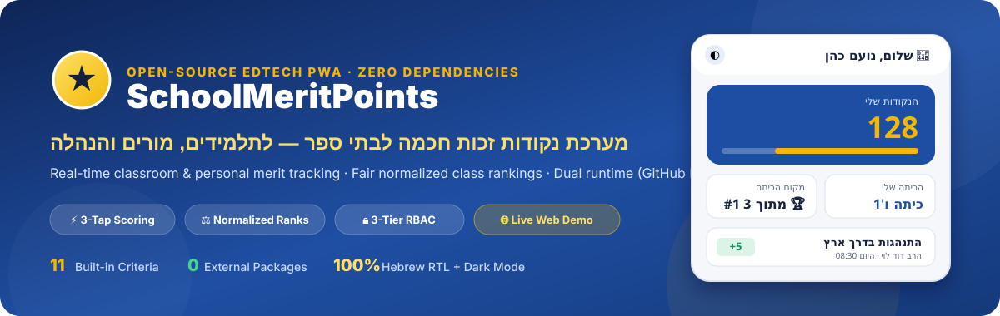
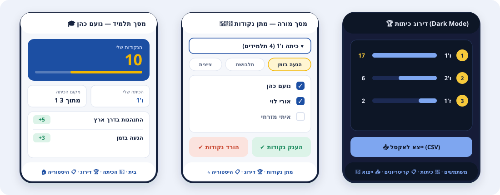
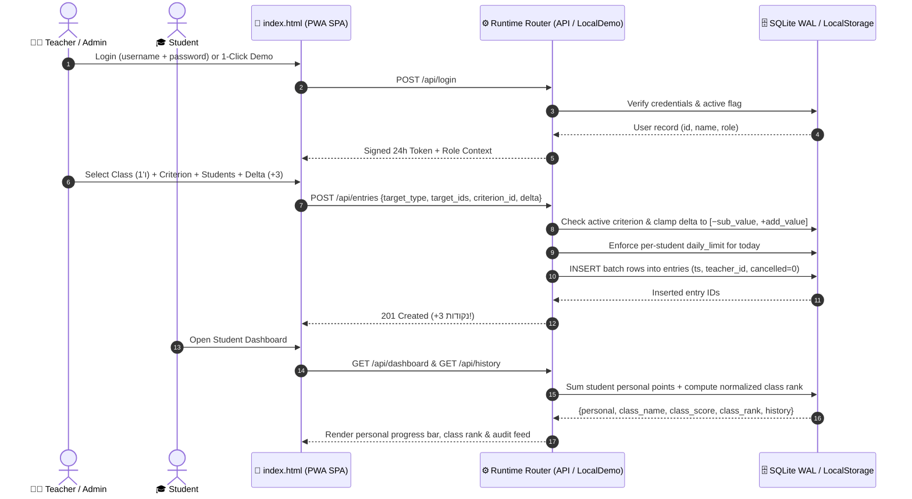
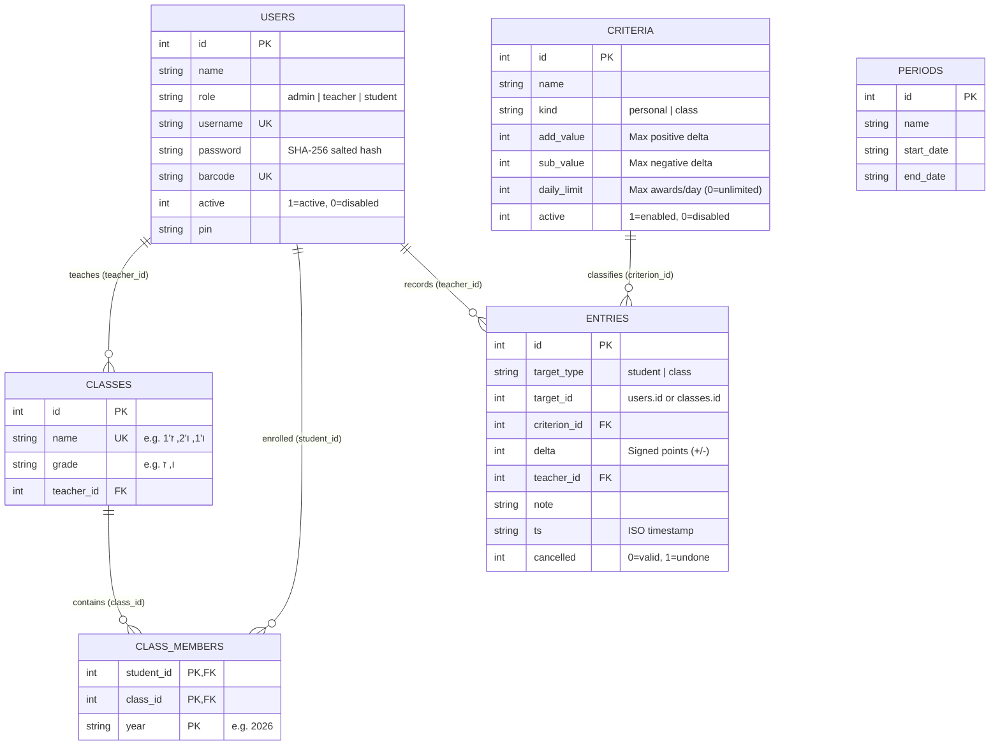

<div align="center">



<br/>

[](https://rajwanyair.github.io/SchoolMeritPoints/)
[](https://github.com/RajwanYair/SchoolMeritPoints/actions)
[-3776AB?style=for-the-badge&logo=python&logoColor=white)](https://www.python.org/)
[](#database-schema-er-diagram)
[](LICENSE)

**A zero-dependency, mobile-first Progressive Web App (PWA) for managing individual and classroom merit points in schools.**  
*אפליקציית רשת חכמה לניהול נקודות זכות אישיות וכיתתיות בבתי ספר — מותאמת לנייד ולמחשב, עם ממשק עברי מלא (RTL) ומצב כהה.*

[🌐 **Launch Live Web App (`index.html`)**](https://rajwanyair.github.io/SchoolMeritPoints/index.html) ·
[🇬🇧 **English Mode (`?lang=en`)**](https://rajwanyair.github.io/SchoolMeritPoints/?lang=en) ·
[🇮🇱 **Hebrew Mode (`?lang=he`)**](https://rajwanyair.github.io/SchoolMeritPoints/?lang=he) ·
[🌙 **Dark Mode (`?theme=dark`)**](https://rajwanyair.github.io/SchoolMeritPoints/?theme=dark) ·
[🎓 **Student Demo**](https://rajwanyair.github.io/SchoolMeritPoints/?demo=student) ·
[👨‍🏫 **Teacher Demo**](https://rajwanyair.github.io/SchoolMeritPoints/?demo=teacher) ·
[🛡️ **Admin Demo**](https://rajwanyair.github.io/SchoolMeritPoints/?demo=admin) ·
[📄 **Interactive Spec (`spec.html`)**](https://rajwanyair.github.io/SchoolMeritPoints/spec.html)

</div>

---

## 🌟 Highlights & Why SchoolMeritPoints Stands Out

| Pillar | What It Delivers |
| :--- | :--- |
| 💻 **PC, Tablet & Mobile Responsive** | Adaptive layout: **Desktop (`≥1024px`)** uses a sticky sidebar navigation rail + multi-column workspace; **Tablet (`768px–1023px`)** uses centered cards & modals; **Mobile (`<768px`)** uses a thumb-friendly bottom tab bar. |
| 🌍 **Bilingual English (LTR) & Hebrew (RTL)** | Instant 1-click `🌐 EN / עב` language switcher across [`index.html`](index.html) and [`spec.html`](spec.html), dynamically switching `dir="ltr"` / `dir="rtl"` and translating all UI labels, criteria, classes, and demo records. |
| 🌓 **Dark & Light Themes Everywhere** | 1-click **`🌓`** theme toggle on every screen (including Login & Specification), persisted in `localStorage` and controllable via `?theme=dark` or `?theme=light`. |
| 🌐 **Run Anywhere on the Web** | Works **instantly on GitHub Pages** via an embedded client-side database engine (`LocalStorage`) **and** as a multi-user school server via `python3 server.py` (`SQLite WAL`). |
| ⚡ **3-Tap Teacher Workflow** | Select a class, tap a criterion chip, select one or multiple students, and award/deduct points in **under 3 seconds**. |
| ⚖️ **Fair Normalized Class Ranking** | Combines direct classroom awards with **50% of the class's average personal score**, preventing large classes from dominating smaller ones. |
| 🔒 **Strict 3-Tier RBAC & Privacy** | **Students** see only their own score & class rank; **Teachers** award points and can undo their own actions within **24 hours**; **Admins** manage users, classes, criteria, and exports. |
| 📦 **Zero External Dependencies** | Pure **Python 3 standard library** (`http.server`, `sqlite3`, `hmac`, `hashlib`) + vanilla HTML5/CSS3/ES2022 SPA. No `npm`, no `pip install`, no build step. |

---

## 💻 Multi-Device, Language & Theme Matrix

| Form Factor / Feature | Breakpoint / Trigger | Adaptive Behavior |
| :--- | :--- | :--- |
| 🖥️ **PC / Desktop** | `≥1024px` | 2-column CSS Grid shell (`240px` vertical navigation sidebar + `980px` workspace), side-by-side Student hero/stats cards, centered dialog modals, elevated login card. |
| 📱 **Tablet (iPad / Android)** | `768px–1023px` | Centered `820px` container, centered class-picker modal, spacious touch targets, landscape & portrait PWA support (`"orientation": "any"`). |
| 📲 **Mobile Phone** | `<768px` | Full-bleed single-column cards, sticky bottom navigation `.tabbar`, bottom-sheet class picker, one-hand operation for teachers. |
| 🇬🇧 **English Mode (LTR)** | `🌐 EN` button or `?lang=en` | Sets `<html lang="en" dir="ltr">`, docks desktop sidebar on the left, translates UI + all 11 criteria, class names (`Grade 6-A`), and demo names. |
| 🇮🇱 **Hebrew Mode (RTL)** | `🌐 עב` button or `?lang=he` | Sets `<html lang="he" dir="rtl">`, docks desktop sidebar on the right, native Hebrew school terminology. |
| 🌓 **Dark / Light Theme** | `🌓` button or `?theme=dark\|light` | Switches CSS custom properties (`data-theme="dark"` / `"light"`), auto-detects OS `prefers-color-scheme`, and persists across sessions. |

---

## 🌐 Live Web App & Instant Role Demos

Open the app on any phone, tablet, or desktop browser—no installation is needed:

- 🔗 **Primary URL**: [https://rajwanyair.github.io/SchoolMeritPoints/](https://rajwanyair.github.io/SchoolMeritPoints/)
- 🔗 **Direct HTML Entry**: [https://rajwanyair.github.io/SchoolMeritPoints/index.html](https://rajwanyair.github.io/SchoolMeritPoints/index.html)

### Pre-Configured Demo Accounts (Web & Local Server)

| Role | Display Name | Username | Password | Live Demo |
| :--- | :--- | :--- | :--- | :--- |
| 🎓 **Student (תלמיד)** | נועם כהן (כיתה ו'1) | `noam` | `1234` | [Student view →](https://rajwanyair.github.io/SchoolMeritPoints/?demo=student) |
| 👨‍🏫 **Teacher (מורה)** | הרב דוד לוי | `david` | `teacher123` | [Teacher view →](https://rajwanyair.github.io/SchoolMeritPoints/?demo=teacher) |
| 🛡️ **Admin (מנהל)** | מנהל מערכת | `admin` | `admin123` | [Admin view →](https://rajwanyair.github.io/SchoolMeritPoints/?demo=admin) |

---

## 📱 Visual Interface Preview

<div align="center">
  
</div>

---

## 🏗️ System Architecture & Scoring Flow (SVG)

<div align="center">
  
</div>

---

## 🔄 Data Flow & Interactive Diagrams (Mermaid)

### 1. End-to-End Request & Scoring Data Flow



### 2. Role-Based Navigation & Access Control Flow


### 3. Database Schema (ER Diagram)



---

## ⚖️ Fair Normalized Class Scoring Formula

A class with 34 students can easily outscore a class with 22 students if rankings are based only on raw points. SchoolMeritPoints prevents this with a normalized composite formula:

$$\text{ClassScore}(c) = \sum_{e \in \text{Direct}(c)} \Delta_e \;+\; \left\lfloor 0.5 \times \frac{1}{|S_c|} \sum_{s \in S_c} \text{StudentScore}(s) \right\rfloor$$

Where:
- $\text{Direct}(c)$: All non-cancelled entries awarded directly to class $c$ (`target_type = 'class'`).
- $S_c$: Active students enrolled in class $c$ (`class_members`).
- $\text{StudentScore}(s)$: Sum of non-cancelled personal entries for student $s$ (`target_type = 'student'`).

---

## 📋 Built-in Merit Criteria & 3-Tier RBAC

- **11 Seeded Merit Criteria** (5 personal: *School Uniform*, *Tzitzit*, *On-Time Arrival*, *Special Study Initiative*, *Exemplary Behavior*; 6 classroom: *Classroom Cleanliness*, *Clean Walls*, *Decorated Classroom*, *Chairs Raised*, *Duty Monitors*, *Organized Cubbies*) — customizable in the Admin console. See the full table in [spec.md §3](spec.md#3-️-merit-criteria--normalized-scoring-math).
- **3-Tier Role-Based Access Control (`student` / `teacher` / `admin`)**: Students view only their own personal score (`403 Forbidden` on other students) and class rankings; Teachers award/deduct points in batch and undo their own entries within 24 hours; Admins manage users, classes, criteria, and exports. See the full permission matrix in [spec.md §2](spec.md#2--user-roles--rbac-permissions).

---

## 🔌 REST API Reference

| Method | Endpoint | Allowed Roles | Description |
| :---: | :--- | :---: | :--- |
| `POST` | `/api/login` | Public | Authenticate with `username` & `password`; returns 24h HMAC token |
| `POST` | `/api/logout` | Any | End current session |
| `GET` | `/api/me` | Any | Return active user profile (`id`, `name`, `role`, `username`) |
| `GET` | `/api/kiosk` | Public | Read-only Hallway TV Kiosk class leaderboard (zero student PII) |
| `GET` | `/api/dashboard` | Any | Role-tailored summary (Student score/rank or Teacher/Admin overview) |
| `GET` | `/api/users` | Teacher, Admin | List active users (`id`, `name`, `role`, `username`) |
| `POST` | `/api/users` | Admin | Create a new user (`name`, `role`, `username`, `password`) |
| `PUT` | `/api/users/:id` | Admin | Update user profile, password, PIN, barcode, or active flag |
| `DELETE` | `/api/users/:id` | Admin | Soft-deactivate user (`active = 0`) |
| `GET` | `/api/classes` | Any | List all classes with teacher name and enrolled student count |
| `POST` | `/api/classes` | Admin | Create a new classroom (`name`, `grade`, `teacher_id`) |
| `PUT` | `/api/classes/:id` | Admin | Update classroom metadata or homeroom teacher |
| `DELETE` | `/api/classes/:id` | Admin | Remove classroom and its enrollment links |
| `POST` | `/api/class-members` | Admin | Enroll a student in a classroom (`student_id`, `class_id`, `year`) |
| `DELETE` | `/api/class-members/:sid/:cid` | Admin | Remove a student from a classroom |
| `GET` | `/api/criteria` | Any | List all personal and classroom merit criteria |
| `POST` | `/api/criteria` | Admin | Create a new merit criterion (`name`, `kind`, `add_value`, `sub_value`, `daily_limit`) |
| `PUT` | `/api/criteria/:id` | Admin | Update criterion values or toggle `active` (`1` / `0`) |
| `POST` | `/api/entries` | Teacher, Admin | Batch-award or deduct points (`target_type`, `target_ids`, `criterion_id`, `delta`) |
| `DELETE` | `/api/entries/:id` | Teacher, Admin | Soft-cancel an entry (`cancelled = 1`; 24h self-window for teachers) |
| `GET` | `/api/rankings/classes` | Any | Ranked list of all classes using the normalized class score formula |
| `GET` | `/api/rankings/students` | Teacher, Admin | Ranked list of students (global or filtered by `?class_id=`) |
| `GET` | `/api/student-score` | Any | Student total score and per-criterion breakdown (students restricted to self) |
| `GET` | `/api/class-score` | Any | Class composite score and member roster with individual totals |
| `GET` | `/api/history` | Any | Chronological audit log (students see only own + own-class events) |
| `GET` | `/api/export` | Teacher, Admin | Download UTF-8 BOM CSV (`points_export.csv`) for Microsoft Excel |

---

## 🚀 Quick Start (Local Python + SQLite Server)

### Prerequisites
- **Python 3.9+** (uses standard library only — no `pip install` needed)

### Run Locally in 10 Seconds

```bash
git clone https://github.com/RajwanYair/SchoolMeritPoints.git
cd SchoolMeritPoints
python3 server.py --port 8080
```

Then open **`http://localhost:8080`** in your browser.

### Command-Line & Environment Options

| Option / Variable | Default | Description |
| :--- | :--- | :--- |
| `--port PORT` | `8080` | TCP port for the HTTP server |
| `--db PATH` | `./points.db` | Path to the SQLite database file (auto-created & seeded on first run) |
| `POINTS_SECRET` | Random 32-byte hex | Secret key used for SHA-256 password salting and HMAC token signing |

---

## 🧪 Automated Test Suite & Quality Gate

Every backend function, HTTP endpoint, frontend JavaScript function, bilingual `I18N` dictionary, responsive CSS breakpoint, SVG asset, configuration file, and documentation table is verified by a zero-dependency `unittest` suite under [`tests/`](tests/):

```bash
# Run the complete test suite (25 test cases covering methods, APIs, UI, i18n, docs and workspace configs)
python3 -m unittest discover -s tests -v

# Enable the automatic Git pre-commit test hook
git config core.hooksPath .githooks
```

| Test Module | Scope & What It Verifies |
| :--- | :--- |
| [`tests/test_server_unit.py`](tests/test_server_unit.py) | `get_db()` (WAL & FK pragmas), `init_db()` (6 tables, 3 indexes, idempotency, seeded users/classes/11 criteria), `hash_password()`, `make_session_token()`, `verify_session_token()` (HMAC & 24h expiry), `_student_score()`, and normalized `_class_score()`. |
| [`tests/test_api_endpoints.py`](tests/test_api_endpoints.py) | Full live HTTP integration tests for all `/api/*` endpoints, static asset serving, CORS `OPTIONS`, Bearer & Cookie auth, 3-tier RBAC enforcement, delta clamping, per-student `daily_limit`, 24-hour teacher self-undo window, student privacy isolation, and UTF-8 BOM CSV export. |
| [`tests/test_frontend_and_i18n.py`](tests/test_frontend_and_i18n.py) | HTML5 DOM integrity, presence of all JavaScript functions in [`index.html`](index.html) and [`spec.html`](spec.html), key parity between `I18N.he` and `I18N.en`, coverage of every `data-i18n` / `data-i18n-ph` attribute, `DATA_EN_MAP` criteria/class translations, PC (`1024px`) & Tablet (`768px`) media queries, and Dark/Light theme rules. |
| [`tests/test_docs_and_configs.py`](tests/test_docs_and_configs.py) | [`manifest.webmanifest`](manifest.webmanifest) schema & `"orientation": "any"`, XML/SVG validity for [`icon.svg`](icon.svg) and [`assets/*.svg`](assets/), local link resolution in [`README.md`](README.md), Mermaid diagram presence, parity between [`server.py`](server.py) routes and [`README.md`](README.md) documentation, and CI/Git config checks. |

---

## 📁 Repository Structure

```text
SchoolMeritPoints/
├── index.html                   # Single-file RTL/LTR Bilingual PWA (Live Server + Serverless Web Demo)
├── server.py                    # Zero-dependency Python 3 HTTP + SQLite WAL backend
├── manifest.webmanifest         # Progressive Web App (PWA) install manifest (PC/Tablet/Mobile)
├── icon.svg                     # Vector star emblem for browser & mobile home screen
├── spec.md                      # Comprehensive English product & architecture specification
├── spec.html                    # Interactive Bilingual (EN/HE) + Dark/Light specification & mockups
├── ROADMAP.md                   # 6-sprint development roadmap (SMP-101..605) & issue backlog (ISS-001..012)
├── assets/
│   ├── hero-banner.svg          # README hero banner with UI preview
│   ├── roadmap-sprints.svg      # 6-sprint agile roadmap visual timeline
│   ├── social-preview.svg       # Open Graph / Twitter Card 1200×630 preview banner
│   ├── system-flow.svg          # Architecture, dual runtime & scoring pipeline diagram
│   ├── ui-preview.svg           # 3-screen mobile UI showcase (Student, Teacher, Dark Mode)
│   └── user-journey.svg         # Daily school merit journey diagram
├── tests/
│   ├── test_server_unit.py      # Unit tests for DB helpers, auth tokens & scoring formulas
│   ├── test_api_endpoints.py    # End-to-end HTTP integration & RBAC tests for all 19 endpoints
│   ├── test_frontend_and_i18n.py# DOM, JS function inventory, EN/HE i18n parity & responsive tests
│   └── test_docs_and_configs.py # Manifest, SVG XML, README/ROADMAP link parity, VS Code & Copilot config tests
├── .vscode/
│   ├── settings.json            # Python unittest, UTF-8/RTL & GitHub Copilot Chat workspace settings
│   ├── tasks.json               # 1-click test, CI quality gate, local server & GitHub status tasks
│   ├── launch.json              # Debugger configurations for server.py and unittest
│   └── extensions.json          # Recommended VS Code extensions
├── .githooks/
│   └── pre-commit               # Git pre-commit hook enforcing the full unittest suite
├── .github/
│   ├── copilot-instructions.md  # Repository-wide GitHub Copilot Chat instructions & invariants
│   ├── prompts/                 # Reusable Copilot Chat slash prompts (/implement-sprint-task, etc.)
│   ├── agents/                  # Custom @smp-developer agent definition
│   ├── ISSUE_TEMPLATE/          # Structured Bug Report & Sprint Task (SMP-xxx) issue forms
│   ├── PULL_REQUEST_TEMPLATE.md # PR quality gate checklist
│   ├── dependabot.yml           # Weekly GitHub Actions version updates
│   └── workflows/
│       ├── ci.yml               # Automated unittest suite + syntax/asset validation on push/PR/tag
│       ├── pages.yml            # Automatic deployment to GitHub Pages on push to main
│       └── release.yml          # Automated release bundle (.tar.gz/.zip/.sha256) & GitHub Release publisher
├── CONTRIBUTING.md              # Contributor guidelines
├── SECURITY.md                  # Security model & production hardening checklist
└── LICENSE                      # MIT License
```

---

## 📄 License

Released under the [MIT License](LICENSE).
