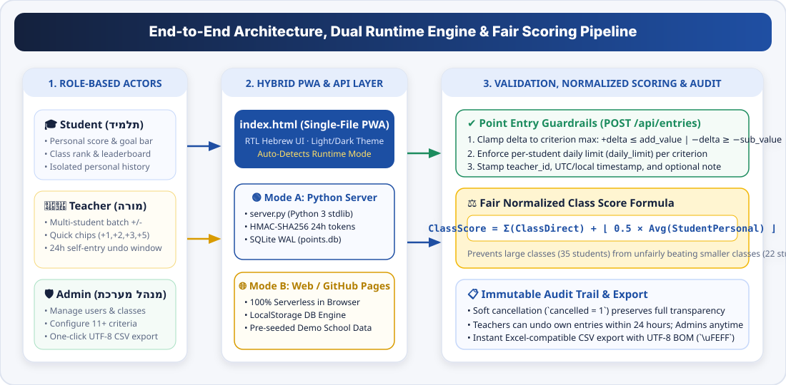
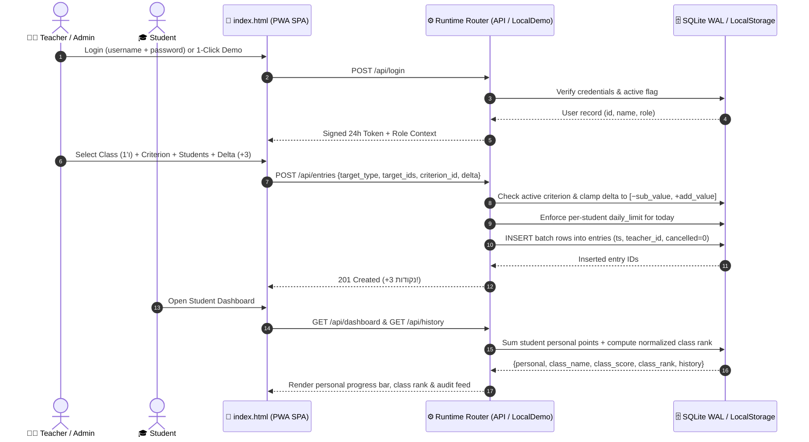
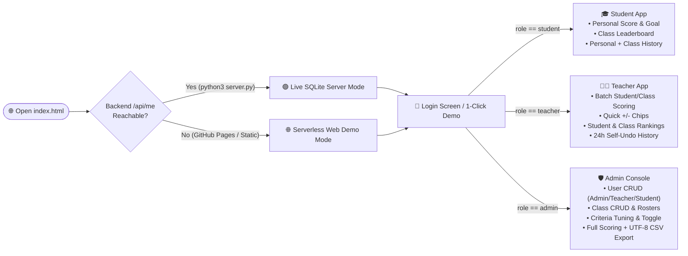
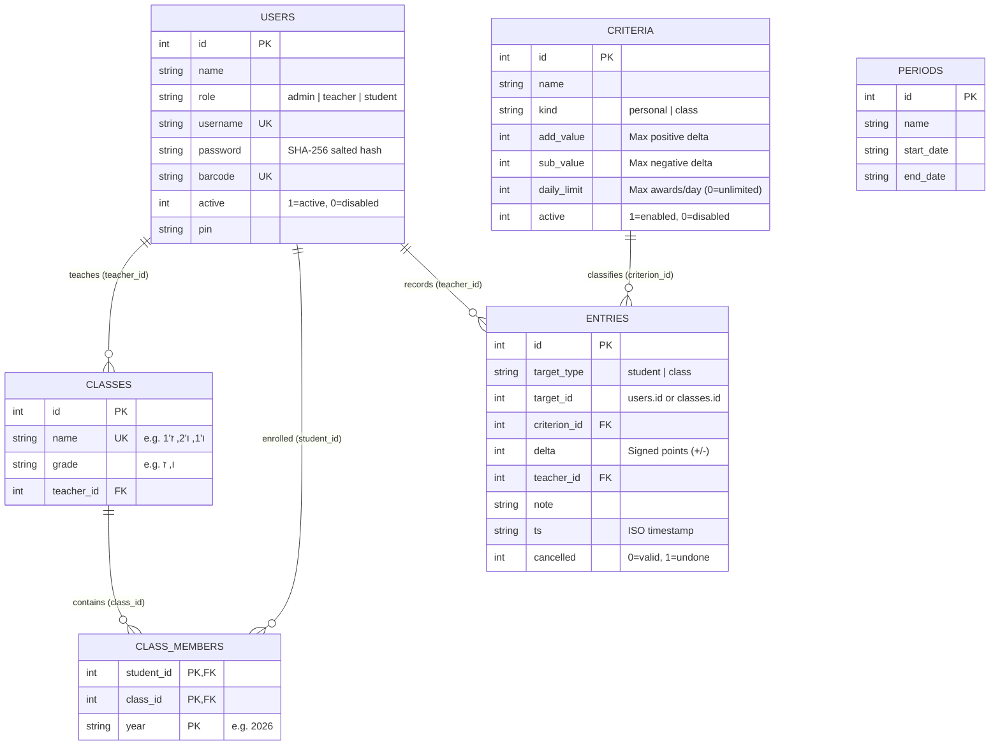

<div align="center">


<br/>

[](https://rajwanyair.github.io/SchoolMeritPoints/)
[](https://github.com/RajwanYair/SchoolMeritPoints/actions)
[-3776AB?style=for-the-badge&logo=python&logoColor=white)](https://www.python.org/)
[](#database-schema-er-diagram)
[](LICENSE)

**A zero-dependency, mobile-first Progressive Web App (PWA) for managing individual and classroom merit points in schools.**  
*אפליקציית רשת חכמה לניהול נקודות זכות אישיות וכיתתיות בבתי ספר — מותאמת לנייד ולמחשב, עם ממשק עברי מלא (RTL) ומצב כהה.*

[🌐 **Launch Live Web App (`index.html`)**](https://rajwanyair.github.io/SchoolMeritPoints/index.html) ·
[�🇧 **English Mode (`?lang=en`)**](https://rajwanyair.github.io/SchoolMeritPoints/?lang=en) ·
[🇮🇱 **Hebrew Mode (`?lang=he`)**](https://rajwanyair.github.io/SchoolMeritPoints/?lang=he) ·
[🌙 **Dark Mode (`?theme=dark`)**](https://rajwanyair.github.io/SchoolMeritPoints/?theme=dark) ·
[🎓 **Student Demo**](https://rajwanyair.github.io/SchoolMeritPoints/?demo=student) ·
[👨‍🏫 **Teacher Demo**](https://rajwanyair.github.io/SchoolMeritPoints/?demo=teacher) ·
[🛡️ **Admin Demo**](https://rajwanyair.github.io/SchoolMeritPoints/?demo=admin) ·
[📄 **Interactive Spec (`spec.html`)**](https://rajwanyair.github.io/SchoolMeritPoints/spec.html)

</div>

---

## 🌟 Highlights & Why SchoolMeritPoints Stands Out

| Pillar | What It Delivers |
| :--- | :--- |
| 💻 **PC, Tablet & Mobile Responsive** | Adaptive layout: **Desktop (`≥ 1024px`)** uses a sticky sidebar navigation rail + multi-column workspace; **Tablet (`768px–1023px`)** uses centered cards & modals; **Mobile (`< 768px`)** uses a thumb-friendly bottom tab bar. |
| 🌍 **Bilingual English (LTR) & Hebrew (RTL)** | Instant 1-click **`🌐 EN / עב`** language switcher across [`index.html`](index.html) and [`spec.html`](spec.html), dynamically switching `dir="ltr"` / `dir="rtl"` and translating all UI labels, criteria, classes, and demo records. |
| 🌓 **Dark & Light Themes Everywhere** | 1-click **`🌓`** theme toggle on every screen (including Login & Specification), persisted in `localStorage` and controllable via `?theme=dark` or `?theme=light`. |
| 🌐 **Run Anywhere on the Web** | Works **instantly on GitHub Pages** via an embedded client-side database engine (`LocalStorage`) **and** as a multi-user school server via `python3 server.py` (`SQLite WAL`). |
| ⚡ **3-Tap Teacher Workflow** | Select a class, tap a criterion chip, select one or multiple students, and award/deduct points in **under 3 seconds**. |
| ⚖️ **Fair Normalized Class Ranking** | Combines direct classroom awards with **50% of the class's average personal score**, preventing large classes from dominating smaller ones. |
| 🔒 **Strict 3-Tier RBAC & Privacy** | **Students** see only their own score & class rank; **Teachers** award points and can undo their own actions within **24 hours**; **Admins** manage users, classes, criteria, and exports. |
| 📦 **Zero External Dependencies** | Pure **Python 3 standard library** (`http.server`, `sqlite3`, `hmac`, `hashlib`) + vanilla HTML5/CSS3/ES2022 SPA. No `npm`, no `pip install`, no build step. |

---

## 💻 Multi-Device, Language & Theme Matrix

| Form Factor / Feature | Breakpoint / Trigger | Adaptive Behavior |
| :--- | :--- | :--- |
| 🖥️ **PC / Desktop** | `≥ 1024px` | 2-column CSS Grid shell (`240px` vertical navigation sidebar + `980px` workspace), side-by-side Student hero/stats cards, centered dialog modals, elevated login card. |
| 📱 **Tablet (iPad / Android)** | `768px – 1023px` | Centered `820px` container, centered class-picker modal, spacious touch targets, landscape & portrait PWA support (`"orientation": "any"`). |
| 📲 **Mobile Phone** | `< 768px` | Full-bleed single-column cards, sticky bottom navigation `.tabbar`, bottom-sheet class picker, one-hand corridor operation for teachers. |
| 🇬🇧 **English Mode (LTR)** | `🌐 EN` button or `?lang=en` | Sets `<html lang="en" dir="ltr">`, docks desktop sidebar on the left, translates UI + all 11 criteria, class names (`Grade 6-A`), and demo names. |
| 🇮🇱 **Hebrew Mode (RTL)** | `🌐 עב` button or `?lang=he` | Sets `<html lang="he" dir="rtl">`, docks desktop sidebar on the right, native Hebrew school terminology. |
| 🌓 **Dark / Light Theme** | `🌓` button or `?theme=dark\|light` | Switches CSS custom properties (`data-theme="dark"` / `"light"`), auto-detects OS `prefers-color-scheme`, and persists across sessions. |

---

## 🌐 Live Web App & Instant Role Demos

You can access [`index.html`](https://rajwanyair.github.io/SchoolMeritPoints/index.html) directly from any phone, tablet, or desktop browser—no installation required:

- 🔗 **Primary URL**: **[https://rajwanyair.github.io/SchoolMeritPoints/](https://rajwanyair.github.io/SchoolMeritPoints/)**
- 🔗 **Direct HTML Entry**: **[https://rajwanyair.github.io/SchoolMeritPoints/index.html](https://rajwanyair.github.io/SchoolMeritPoints/index.html)**

### Pre-Configured Demo Accounts (Web & Local Server)

| Role | Display Name | Username | Password | One-Click Live Launch |
| :--- | :--- | :--- | :--- | :--- |
| 🎓 **Student (תלמיד)** | נועם כהן (כיתה ו'1) | `noam` | `1234` | [Launch Student View →](https://rajwanyair.github.io/SchoolMeritPoints/?demo=student) |
| 👨‍🏫 **Teacher (מורה)** | הרב דוד לוי | `david` | `teacher123` | [Launch Teacher View →](https://rajwanyair.github.io/SchoolMeritPoints/?demo=teacher) |
| 🛡️ **Admin (מנהל)** | מנהל מערכת | `admin` | `admin123` | [Launch Admin View →](https://rajwanyair.github.io/SchoolMeritPoints/?demo=admin) |

---

## 📱 Visual Interface Preview

<div align="center">
  
</div>

---

## 🏗️ System Architecture & Scoring Flow (SVG)

<div align="center">
  
</div>

---

## 🔄 Data Flow & Interactive Diagrams (Mermaid)

### 1. End-to-End Request & Scoring Data Flow



### 2. Role-Based Navigation & Access Control Flow



### 3. Database Schema (ER Diagram)



---

## ⚖️ Fair Normalized Class Scoring Formula

In many school merit systems, a class with **34 students** automatically accumulates more total points than a class with **22 students**. **SchoolMeritPoints** solves this with a normalized composite formula:

$$\text{ClassScore}(c) = \sum_{e \in \text{Direct}(c)} \Delta_e \;+\; \left\lfloor 0.5 \times \frac{1}{|S_c|} \sum_{s \in S_c} \text{StudentScore}(s) \right\rfloor$$

Where:
- $\text{Direct}(c)$: All non-cancelled entries awarded directly to class $c$ (`target_type = 'class'`).
- $S_c$: Active students enrolled in class $c$ (`class_members`).
- $\text{StudentScore}(s)$: Sum of non-cancelled personal entries for student $s$ (`target_type = 'student'`).

---

## 📋 Built-in Merit Criteria (11 Default Rules)

All criteria are seeded automatically on first launch and can be customized or toggled by an Administrator at any time:

| # | Hebrew Name | English Meaning | Scope (`kind`) | Award (`+`) | Deduct (`−`) | Daily Limit |
| :-: | :--- | :--- | :---: | :---: | :---: | :---: |
| 1 | **תלבושת** | School Uniform | `personal` | `+2` | `−1` | 1 / day |
| 2 | **ציצית** | Tzitzit | `personal` | `+2` | `−1` | 1 / day |
| 3 | **הגעה בזמן** | Punctuality / On-Time Arrival | `personal` | `+3` | `−2` | 1 / day |
| 4 | **מבצע חל"ל** | Special Study / Chesed Initiative | `personal` | `+5` | — | Unlimited |
| 5 | **התנהגות בדרך ארץ** | Exemplary Behavior & Derech Eretz | `personal` | `+5` | `−3` | Unlimited |
| 6 | **סדר וניקיון הכיתה** | Classroom Order & Cleanliness | `class` | `+5` | `−3` | 1 / day |
| 7 | **קירות נקיים** | Clean Classroom Walls | `class` | `+3` | `−3` | Unlimited |
| 8 | **כיתה מקושטת** | Decorated Classroom | `class` | `+10` | — | Unlimited |
| 9 | **הרמת כיסאות בסוף היום** | Chairs Raised at End of Day | `class` | `+2` | `−2` | 1 / day |
| 10 | **תורנים כיתתיים** | Classroom Duty Monitors | `class` | `+3` | `−2` | 1 / day |
| 11 | **כוורות מסודרות** | Organized Cubbies / Lockers | `class` | `+3` | `−2` | Unlimited |

---

## 🔐 Role-Based Access Control (RBAC) Matrix

| Capability | 🎓 Student | 👨‍🏫 Teacher | 🛡️ Admin |
| :--- | :---: | :---: | :---: |
| View own personal score, progress & history | ✅ | — | — |
| View other students' individual scores | ❌ *(Blocked 403)* | ✅ | ✅ |
| View normalized class leaderboard | ✅ | ✅ | ✅ |
| Award / deduct personal & classroom points (single or batch) | ❌ | ✅ | ✅ |
| Cancel / undo an entry | ❌ | ✅ *(Own entries, < 24h)* | ✅ *(Any entry, anytime)* |
| Create / deactivate users & classes | ❌ | ❌ | ✅ |
| Add / edit / toggle merit criteria | ❌ | ❌ | ✅ |
| Export full audit log to Excel-ready UTF-8 CSV | ❌ | ✅ | ✅ |

---

## 🔌 REST API Reference

| Method | Endpoint | Allowed Roles | Description |
| :---: | :--- | :---: | :--- |
| `POST` | `/api/login` | Public | Authenticate with `username` & `password`; returns 24h HMAC token |
| `POST` | `/api/logout` | Any | End current session |
| `GET` | `/api/me` | Any | Return active user profile (`id`, `name`, `role`, `username`) |
| `GET` | `/api/dashboard` | Any | Role-tailored summary (Student score/rank or Teacher/Admin overview) |
| `GET` | `/api/classes` | Any | List all classes with teacher name and enrolled student count |
| `POST` | `/api/classes` | Admin | Create a new classroom (`name`, `grade`, `teacher_id`) |
| `PUT` | `/api/classes/:id` | Admin | Update classroom metadata or homeroom teacher |
| `DELETE` | `/api/classes/:id` | Admin | Remove classroom and its enrollment links |
| `GET` | `/api/criteria` | Any | List all personal and classroom merit criteria |
| `POST` | `/api/criteria` | Admin | Create a new merit criterion (`name`, `kind`, `add_value`, `sub_value`, `daily_limit`) |
| `PUT` | `/api/criteria/:id` | Admin | Update criterion values or toggle `active` (`1` / `0`) |
| `POST` | `/api/entries` | Teacher, Admin | Batch-award or deduct points (`target_type`, `target_ids`, `criterion_id`, `delta`) |
| `DELETE` | `/api/entries/:id` | Teacher, Admin | Soft-cancel an entry (`cancelled = 1`; 24h self-window for teachers) |
| `GET` | `/api/rankings/classes` | Any | Ranked list of all classes using the normalized class score formula |
| `GET` | `/api/rankings/students` | Teacher, Admin | Ranked list of students (global or filtered by `?class_id=`) |
| `GET` | `/api/student-score` | Any | Student total score and per-criterion breakdown (students restricted to self) |
| `GET` | `/api/class-score` | Any | Class composite score and member roster with individual totals |
| `GET` | `/api/history` | Any | Chronological audit log (students see only own + own-class events) |
| `GET` | `/api/export` | Teacher, Admin | Download UTF-8 BOM CSV (`points_export.csv`) for Microsoft Excel |

---

## 🚀 Quick Start (Local Python + SQLite Server)

### Prerequisites
- **Python 3.9+** (uses standard library only — no `pip install` needed)

### Run Locally in 10 Seconds

```bash
git clone https://github.com/RajwanYair/SchoolMeritPoints.git
cd SchoolMeritPoints
python3 server.py --port 8080
```

Then open **`http://localhost:8080`** in your browser.

### Command-Line & Environment Options

| Option / Variable | Default | Description |
| :--- | :--- | :--- |
| `--port PORT` | `8080` | TCP port for the HTTP server |
| `--db PATH` | `./points.db` | Path to the SQLite database file (auto-created & seeded on first run) |
| `POINTS_SECRET` | Random 32-byte hex | Secret key used for SHA-256 password salting and HMAC token signing |

---

## 📁 Repository Structure

```text
SchoolMeritPoints/
├── index.html                   # Single-file RTL Hebrew PWA (Live Server + Serverless Web Demo Engine)
├── server.py                    # Zero-dependency Python 3 HTTP + SQLite WAL backend
├── manifest.webmanifest         # Progressive Web App (PWA) install manifest
├── icon.svg                     # Vector star emblem for browser & mobile home screen
├── spec.md                      # Comprehensive English product & architecture specification
├── spec.html                    # Original Hebrew interactive product specification
├── assets/
│   ├── hero-banner.svg          # README hero banner with UI preview
│   ├── system-flow.svg          # Architecture, dual runtime & scoring pipeline diagram
│   └── ui-preview.svg           # 3-screen mobile UI showcase (Student, Teacher, Dark Mode)
├── .github/
│   └── workflows/
│       ├── ci.yml               # Automated Python, HTML, SVG & API integration tests
│       └── pages.yml            # Automatic deployment to GitHub Pages on push to main
├── CONTRIBUTING.md              # Contributor guidelines
├── SECURITY.md                  # Security model & production hardening checklist
└── LICENSE                      # MIT License
```

---

## 📄 License

Released under the [MIT License](LICENSE).
