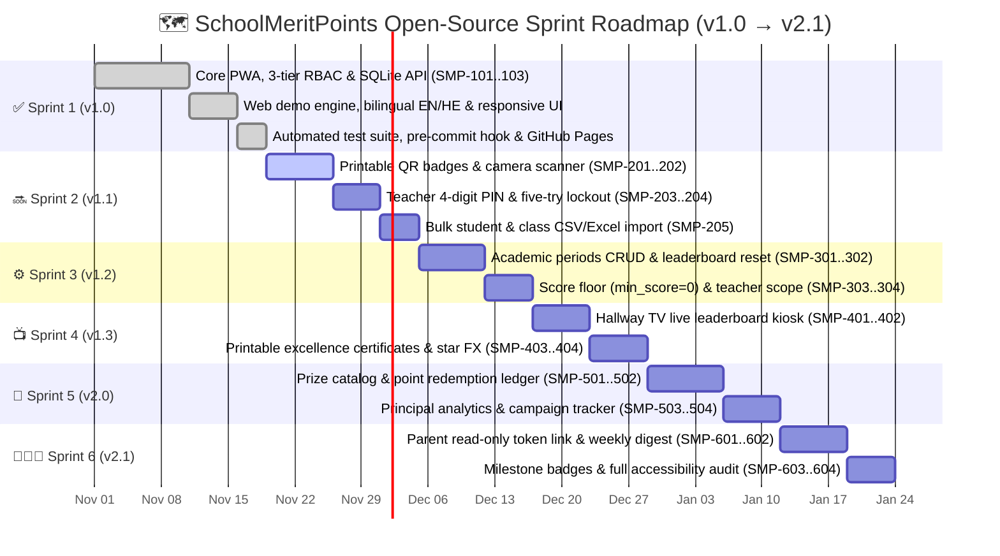
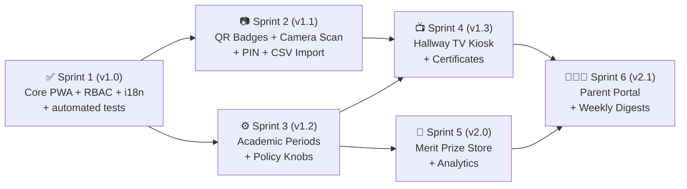

# 🗺️ SchoolMeritPoints — Agile Sprint Roadmap

**Open-Source Development Plan · Sprints 1–6 (`SMP-101` – `SMP-604`)**

[🚀 **Live Web App (`index.html`)**](https://rajwanyair.github.io/SchoolMeritPoints/index.html) ·
[📄 **Specification (`spec.md`)**](spec.md) ·
[🎨 **Visual Spec (`spec.html`)**](https://rajwanyair.github.io/SchoolMeritPoints/spec.html) ·
[📖 **Main README (`README.md`)**](README.md)

---

## 📊 Sprint Summary

Features from the product specification are split into **six focused sprints**. Every task (`SMP-xxx`) is scoped to specific files and endpoints and must include `unittest` coverage under [`tests/`](tests/).

| Sprint | Release | Status | Focus Area | Tasks | Story Points |
| :---: | :---: | :---: | :--- | :---: | :---: |
| **Sprint 1** | `v1.0` | ✅ **Completed** | Core PWA, 3-Tier RBAC, bilingual (EN/HE), dark/light mode, dual runtime & test suite | `SMP-101` – `SMP-106` | `26 SP` |
| **Sprint 2** | `v1.1` | 🔜 **Next Up** | QR badges, camera scanner, teacher PIN gate, lockout & CSV roster import | `SMP-201` – `SMP-205` | `21 SP` |
| **Sprint 3** | `v1.2` | 📅 **Planned** | Academic periods rollover, non-negative score floor & teacher scope knobs | `SMP-301` – `SMP-304` | `16 SP` |
| **Sprint 4** | `v1.3` | 📅 **Planned** | Hallway TV leaderboard kiosk, printable certificates & star animation | `SMP-401` – `SMP-404` | `18 SP` |
| **Sprint 5** | `v2.0` | 📅 **Planned** | Merit prize store, point redemption ledger & principal analytics charts | `SMP-501` – `SMP-504` | `21 SP` |
| **Sprint 6** | `v2.1` | 📅 **Planned** | Read-only parent portal, automated weekly digests & milestone notifications | `SMP-601` – `SMP-604` | `16 SP` |

---

## 📅 Mermaid Sprint Timeline & Dependency Graphs

### 1. Agile Sprint Schedule (`gantt`)

### 2. Sprint Dependency & Feature Flow (`flowchart LR`)

---

## 📋 Detailed Sprint Backlogs

### ✅ Sprint 1 (`v1.0` — Completed & Live)
**Goal**: Deliver a production-ready, zero-dependency school merit PWA with dual runtime (Python/SQLite + GitHub Pages LocalStorage), bilingual EN/HE support, dark/light themes, and full automated test enforcement.

| Task ID | Task Title | Target Files | Points | Status | Verification Gate |
| :---: | :--- | :--- | :---: | :---: | :--- |
| `SMP-101` | 🗄️ **SQLite WAL schema & 3-tier RBAC server** | [`server.py`](server.py) | `5` | ✅ Done | [`tests/test_server_unit.py`](tests/test_server_unit.py) |
| `SMP-102` | ⚖️ **11 default criteria & normalized class score formula** | [`server.py`](server.py), [`index.html`](index.html) | `5` | ✅ Done | [`tests/test_server_unit.py`](tests/test_server_unit.py) |
| `SMP-103` | 🌐 **Serverless browser DB engine (`localApi`) for GitHub Pages** | [`index.html`](index.html) | `5` | ✅ Done | [`tests/test_frontend_and_i18n.py`](tests/test_frontend_and_i18n.py) |
| `SMP-104` | 💻 **Responsive PC, tablet & mobile layout** | [`index.html`](index.html), [`spec.html`](spec.html), [`manifest.webmanifest`](manifest.webmanifest) | `4` | ✅ Done | [`tests/test_frontend_and_i18n.py`](tests/test_frontend_and_i18n.py) |
| `SMP-105` | 🌍 **Bilingual English / Hebrew & dark/light mode** | [`index.html`](index.html), [`spec.html`](spec.html) | `4` | ✅ Done | [`tests/test_frontend_and_i18n.py`](tests/test_frontend_and_i18n.py) |
| `SMP-106` | 🧪 **Full automated test suite + Git pre-commit & CI gate** | [`tests/`](tests/), [`.githooks/pre-commit`](.githooks/pre-commit), [`.github/workflows/ci.yml`](.github/workflows/ci.yml) | `3` | ✅ Done | `python3 -m unittest discover -s tests -v` |

---

### 🔜 Sprint 2 (`v1.1` — QR Badges, Auth Hardening & Bulk Import)
**Goal**: Enable sub-three-second morning-gate student scanning, printable QR cards, brute-force lockout protection, and one-click CSV student roster import.

| Task ID | Task Title | Target Files / Endpoints | Points | Acceptance Criteria & Required Tests |
| :---: | :--- | :--- | :---: | :--- |
| `SMP-201` | 🏷️ **UUID QR badge generation & printable sheet** | `server.py` (`POST /api/users/:id/rotate-qr`), `index.html` (Admin Print View) | `5` | Admin generates/rotates a random `barcode` token per user and prints an A4 badge grid; unit test verifies token uniqueness and instant revocation of lost cards. |
| `SMP-202` | 📸 **Camera QR login & morning gate quick-scan** | `server.py` (`POST /api/login-qr`), `index.html` (`BarcodeDetector` / camera modal) | `5` | Students log in via QR scan in under three seconds; teachers scan student QR cards at the school gate to award *Punctuality* / *Uniform* points in one tap; API test verifies `/api/login-qr`. |
| `SMP-203` | 🔢 **Teacher 4-digit PIN verification for QR login** | `server.py`, `index.html` (`#loginPinWrap`) | `3` | When a teacher scans their QR badge, a 4-digit `pin` is required before issuing a write-capable session token; student QR login remains single-step. |
| `SMP-204` | 🛡️ **Five-attempt login lockout & first-login password change** | `server.py` (`api_login`), `index.html` | `3` | Lock account for 15 minutes after five consecutive failed password/PIN attempts (`429 Too Many Requests`); test verifies lockout counter and admin reset. |
| `SMP-205` | 📥 **Bulk student & class roster import (CSV / Excel)** | `server.py` (`POST /api/import/students`), `index.html` (Admin Import Modal) | `5` | Admin uploads a UTF-8 CSV file (`name,username,class_name,grade`) to create/enroll 30+ students in one transaction; integration test verifies idempotent bulk import. |

---

### ⚙️ Sprint 3 (`v1.2` — Academic Periods & School Policy Knobs)
**Goal**: Activate the `periods` table so schools can run monthly, semester, or annual competitions while preserving historical data, and expose school policy toggles in the Admin UI.

| Task ID | Task Title | Target Files / Endpoints | Points | Acceptance Criteria & Required Tests |
| :---: | :--- | :--- | :---: | :--- |
| `SMP-301` | 🗓️ **Academic periods CRUD & active period filter** | `server.py` (`GET/POST/PUT /api/periods`), `index.html` | `5` | Admin defines named periods (`start_date`, `end_date`); leaderboards and student scores filter by active period while full history remains queryable. |
| `SMP-302` | 🔄 **One-click period rollover & archive snapshot** | `server.py` (`POST /api/periods/rollover`), `index.html` | `4` | Starting a new period resets active leaderboards to `0` without deleting past `entries`; unit test confirms zero data loss across period boundaries. |
| `SMP-303` | 🛡️ **Configurable non-negative score floor (`min_score = 0`)** | `server.py` (`_student_score`, `_class_score`), `index.html` | `3` | School setting `clamp_zero_floor` prevents student or class displayed totals from dropping below `0` (configurable on/off by Admin). |
| `SMP-304` | 🏫 **School policy settings table (class weight, student rank visibility, teacher scope)** | `server.py` (`GET/PUT /api/settings`), `index.html` | `4` | Admin configures personal-average weight (default `0.5`), whether students can view in-class student rankings (default `false`), and whether teachers can score all classes or only assigned classes. |

---

### 📺 Sprint 4 (`v1.3` — Hallway TV Kiosk, Certificates & Live Sync)
**Goal**: Bring merit recognition into school hallways with a live TV leaderboard display, printable excellence certificates, and celebratory visual feedback.

| Task ID | Task Title | Target Files / Endpoints | Points | Acceptance Criteria & Required Tests |
| :---: | :--- | :--- | :---: | :--- |
| `SMP-401` | 🖥️ **Hallway TV live leaderboard kiosk mode (`?kiosk=1`)** | `index.html`, `server.py` (`GET /api/kiosk`) | `5` | Full-screen, read-only public TV view showing class rankings and recent classroom achievements with automatic 30-second refresh and zero student PII exposure. |
| `SMP-402` | 📜 **Auto-generated printable excellence certificates** | `index.html`, `assets/certificate-template.svg` | `5` | One-click bilingual (EN/HE) printable SVG/PDF certificate generator for students reaching their monthly goal threshold or top-ranked classes. |
| `SMP-403` | ✨ **Star-burst celebration animation on point award** | `index.html` | `4` | Trigger a smooth, accessible SVG star-burst animation when points are awarded (respecting `prefers-reduced-motion`). |
| `SMP-404` | 🔄 **Auto-refresh / polling sync (<60s student screen update)** | `index.html` | `4` | Student dashboard automatically refreshes score and recent feed every 30 seconds when visible so updates appear within one minute without manual reload. |

---

### 🎁 Sprint 5 (`v2.0` — Merit Prize Store & School Analytics)
**Goal**: Allow students or classes to redeem earned points for school rewards while keeping lifetime merit rankings intact, and provide trend analytics for educators.

| Task ID | Task Title | Target Files / Endpoints | Points | Acceptance Criteria & Required Tests |
| :---: | :--- | :--- | :---: | :--- |
| `SMP-501` | 🛍️ **Prize catalog management (`prizes` table & Admin UI)** | `server.py` (`/api/prizes`), `index.html` | `5` | Admin creates personal and classroom rewards with point cost, icon/emoji, and available stock count. |
| `SMP-502` | 💳 **Point redemption ledger (`redemptions` table)** | `server.py` (`POST /api/redemptions`), `index.html` | `6` | Separate *lifetime merit score* (for leaderboards) from *spendable point balance* (`Earned − Redeemed`); teachers/admins approve redemptions with full audit trail. |
| `SMP-503` | 📊 **Homeroom teacher & principal trend reports** | `server.py` (`GET /api/analytics`), `index.html` | `5` | Interactive SVG bar/line charts showing weekly point trends by class, top positive criteria, and participation rates. |
| `SMP-504` | 🏅 **Special campaign tracker (e.g., study / chesed initiatives)** | `server.py`, `index.html` | `5` | Dedicated campaign progress bar and badge for time-bounded school-wide initiatives (`מבצע חל"ל`). |

---

### 👨‍👩‍👧 Sprint 6 (`v2.1` — Parent Portal, Weekly Digests & Milestones)
**Goal**: Engage parents with positive, privacy-safe read-only progress views and weekly summaries.

| Task ID | Task Title | Target Files / Endpoints | Points | Acceptance Criteria & Required Tests |
| :---: | :--- | :--- | :---: | :--- |
| `SMP-601` | 👀 **Read-only parent access link / token** | `server.py` (`GET /api/parent-view`), `index.html` | `5` | Admin generates a revocable read-only token per student allowing parents to view only their child's score, positive history, and class rank without a password. |
| `SMP-602` | 📬 **Automated weekly parent summary generator** | `server.py` (`GET /api/reports/weekly-digest`), `index.html` | `4` | Generates a formatted bilingual weekly summary per student suitable for school newsletter/messaging distribution. |
| `SMP-603` | 🎖️ **Student milestone badges (bronze / silver / gold star)** | `index.html`, `server.py` | `4` | Visual milestone badges unlocked at `50`, `100`, and `200` personal points on the Student dashboard. |
| `SMP-604` | ♿ **Full WCAG 2.1 / IS 5568 AA accessibility & keyboard audit** | `index.html`, `spec.html`, `tests/test_frontend_and_i18n.py` | `3` | Automated ARIA label, contrast ratio, focus-trap, and screen-reader landmark tests across all modals and tabs. |

---

## 🛠️ How to Contribute to a Sprint Task

1. Pick an open task ID (e.g. `SMP-201`) from the table above.
2. Create a feature branch: `git checkout -b feat/SMP-201-qr-badges`.
3. Implement the backend/frontend changes **and** add corresponding unit/API tests in [`tests/`](tests/).
4. Run the test suite locally (`python3 -m unittest discover -s tests -v`). The `.githooks/pre-commit` hook will also run the tests automatically before each commit.
5. Open a Pull Request referencing the `SMP-xxx` task ID.
