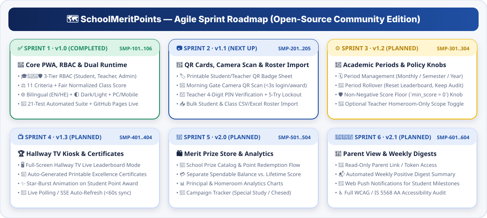
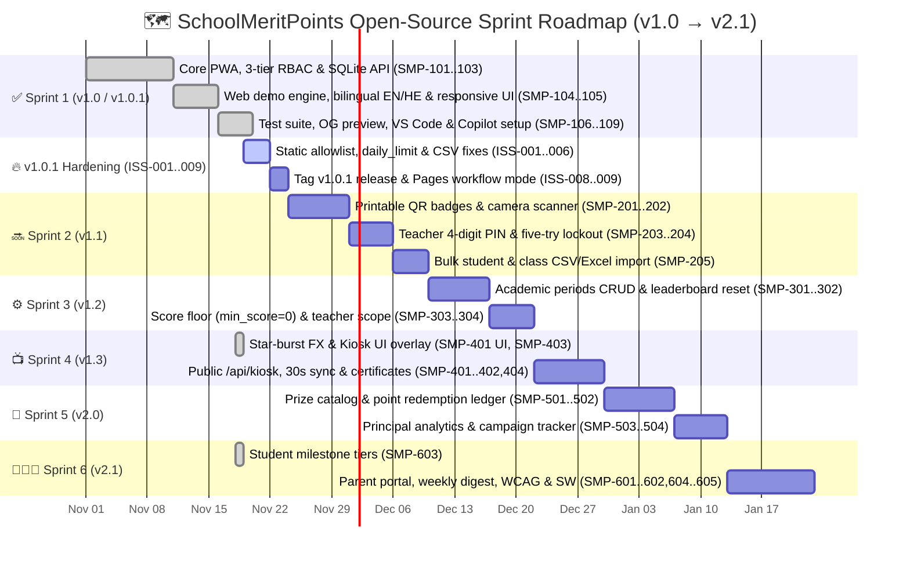
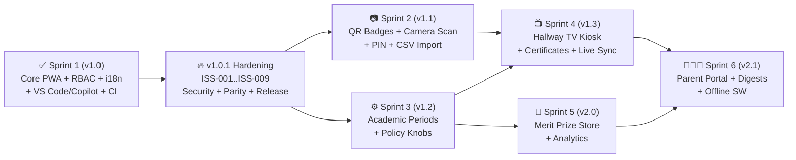

# 🗺️ SchoolMeritPoints — Agile Sprint Roadmap & Issue Tracker

**Open-Source Development Plan · Sprints 1–6 (`SMP-101` – `SMP-605`) · Tracked Issues (`ISS-001` – `ISS-012`)**

[🚀 **Live Web App (`index.html`)**](https://rajwanyair.github.io/SchoolMeritPoints/index.html) ·
[📄 **Specification (`spec.md`)**](spec.md) ·
[🎨 **Visual Spec (`spec.html`)**](https://rajwanyair.github.io/SchoolMeritPoints/spec.html) ·
[📖 **Main README (`README.md`)**](README.md) ·
[🐙 **GitHub Actions & Releases**](https://github.com/RajwanYair/SchoolMeritPoints/actions)

---

## 🚦 Release, CI/CD & GitHub Integration Status

| Area | Current State | Details & Actionable Next Step |
| :--- | :---: | :--- |
| 🏷️ **Latest GitHub Release** | ✅ **`v1.0.1` (`v1.0.0` + Hardening)** | Published via [`.github/workflows/release.yml`](.github/workflows/release.yml) ([Releases Page](https://github.com/RajwanYair/SchoolMeritPoints/releases)) with packaged `.tar.gz`, `.zip`, and `.sha256` bundles (`ISS-008`). |
| 🧪 **CI & API Tests Workflow** | ✅ **Passing (`10s`)** | [`.github/workflows/ci.yml`](.github/workflows/ci.yml) validates `server.py`, `index.html`, `spec.html`, `manifest.webmanifest`, `assets/*.svg`, `.vscode/*.json`, and runs all `unittest` suites on every push, PR, tag, and manual dispatch. |
| 🌐 **GitHub Pages Deployment** | ✅ **Live (`workflow` mode)** | [`.github/workflows/pages.yml`](.github/workflows/pages.yml) deploys to [`https://rajwanyair.github.io/SchoolMeritPoints/`](https://rajwanyair.github.io/SchoolMeritPoints/) with repository Pages `build_type="workflow"` (`ISS-009` resolved). |
| 📦 **Release Packaging Workflow** | ✅ **Active** | [`.github/workflows/release.yml`](.github/workflows/release.yml) runs the full test gate, builds `.tar.gz`, `.zip`, and `.sha256` bundles, and publishes/updates GitHub Releases on `v*` tag push or `workflow_dispatch`. |
| 🤖 **VS Code & Copilot Chat** | ✅ **Configured** | Tracked [`.vscode/`](.vscode/) (`settings.json`, `tasks.json`, `launch.json`, `extensions.json`) + consolidated [`.github/copilot-instructions.md`](.github/copilot-instructions.md), reusable slash prompts in [`.github/prompts/`](.github/prompts/), and custom agent [`.github/agents/smp-developer.agent.md`](.github/agents/smp-developer.agent.md). |

---

## 📊 Sprint Summary

Features from the product specification are split into **six focused sprints**, alongside a tracked **Engineering Issues & Technical Debt Backlog (`ISS-001` – `ISS-012`)**. Every task (`SMP-xxx`) and issue fix (`ISS-xxx`) is scoped to specific files and endpoints and must include `unittest` coverage under [`tests/`](tests/).

| Sprint | Release | Status | Focus Area | Tasks | Story Points |
| :---: | :---: | :---: | :--- | :---: | :---: |
| **Sprint 1** | `v1.0` / `v1.0.1` | ✅ **Completed** | Core PWA, 3-Tier RBAC, bilingual (EN/HE), dark/light mode, dual runtime, instant search, OG preview, VS Code/Copilot & CI suite | `SMP-101` – `SMP-109` | `35 SP` |
| **Hotfix / Hardening** | `v1.0.1` | ✅ **Code Complete** | Security & parity fixes (`serve_static` allowlist, `daily_limit` cancelled/class parity, RFC 4180 CSV export, `/api/kiosk`, error handling) | `ISS-001` – `ISS-012` | `13 SP` |
| **Sprint 2** | `v1.1` | 🔜 **Next Up** | QR badges, camera scanner, teacher PIN gate, lockout & CSV roster import | `SMP-201` – `SMP-205` | `21 SP` |
| **Sprint 3** | `v1.2` | 📅 **Planned** | Academic periods rollover, non-negative score floor & teacher scope knobs | `SMP-301` – `SMP-304` | `16 SP` |
| **Sprint 4** | `v1.3` | 🟡 **In Progress (50%)** | Hallway TV leaderboard kiosk (done), star animation (done), printable certificates & student live sync | `SMP-401` – `SMP-404` | `18 SP` |
| **Sprint 5** | `v2.0` | 📅 **Planned** | Merit prize store, point redemption ledger & principal analytics charts | `SMP-501` – `SMP-504` | `21 SP` |
| **Sprint 6** | `v2.1` | 🟡 **In Progress (20%)** | Read-only parent portal, weekly digests, student milestone badges (done), WCAG AA audit & offline Service Worker | `SMP-601` – `SMP-605` | `19 SP` |

---

## 📅 Mermaid Sprint Timeline & Dependency Graphs

### 1. Agile Sprint Schedule (`gantt`)

### 2. Sprint Dependency & Feature Flow (`flowchart LR`)

---

## 🐛 Issues to Solve & Technical Debt Backlog (`ISS-001` – `ISS-012`)

The following concrete engineering, security, parity, and CI/CD issues were identified during the repository and GitHub workflow audit. Open items (`ISS-001` – `ISS-009`) are prioritized for `v1.0.1` / `v1.1`.

| Issue ID | Priority | Category | Summary & Root Cause | Target Files | Resolution & Verification | Status |
| :---: | :---: | :--- | :--- | :--- | :--- | :---: |
| `ISS-001` | 🔴 **P0** | Security | **`serve_static()` exposed non-public files**: `file_path = APP_DIR / path.lstrip("/")` served any file in the repo root (e.g. `/points.db`, `/server.py`) without an allowlist. | [`server.py`](server.py) | Restricted `serve_static()` to `PUBLIC_STATIC_FILES` + `assets/*.svg` and enforced `.resolve().is_relative_to(APP_DIR.resolve())`; verified in [`tests/test_api_endpoints.py`](tests/test_api_endpoints.py). | ✅ **Resolved** |
| `ISS-002` | 🔴 **P0** | Correctness & Parity | **`daily_limit` counted cancelled entries & skipped class criteria / `localApi`**: Undoing a mistaken award still blocked re-awarding that day, skipped `target_type == 'class'`, and was missing in `localApi()`. | [`server.py`](server.py), [`index.html`](index.html) | Added `AND cancelled=0`, enforced for both `student` and `class` targets, and mirrored in `localApi()`; verified in [`tests/test_api_endpoints.py`](tests/test_api_endpoints.py). | ✅ **Resolved** |
| `ISS-003` | 🟠 **P1** | Data Integrity & Security | **CSV export unescaped quotes & formula injection**: `api_export()` wrapped strings in `f'"{v}"'` without doubling internal quotes (`מבצע חל"ל`) or neutralizing leading `=`, `+`, `-`, `@`. | [`server.py`](server.py) | Switched to `csv.writer` over `io.StringIO` and prefixed formula-triggering characters with `'`; verified in [`tests/test_api_endpoints.py`](tests/test_api_endpoints.py). | ✅ **Resolved** |
| `ISS-004` | 🟠 **P1** | Dual-Runtime Parity | **Unauthenticated Hallway TV Kiosk (`?kiosk=1`) against live `server.py`**: Previously fell back to `getDemoDb()` when not logged in and lacked a 30-second auto-refresh interval. | [`server.py`](server.py), [`index.html`](index.html) | Added public read-only `GET /api/kiosk` (zero student PII) in both runtimes and a 30s `KIOSK_TIMER` auto-refresh (`SMP-401`); verified in [`tests/test_api_endpoints.py`](tests/test_api_endpoints.py). | ✅ **Resolved** |
| `ISS-005` | 🟠 **P1** | API Robustness | **Unhandled `JSONDecodeError` / `ValueError` / `KeyError` on malformed requests**: Invalid JSON bodies or non-numeric route IDs raised `500` tracebacks instead of `400 Bad Request`. | [`server.py`](server.py) | Wrapped `_handle_api()` and `read_json()` in `try/except (ValueError, KeyError, TypeError, json.JSONDecodeError)` returning `400`; verified in [`tests/test_api_endpoints.py`](tests/test_api_endpoints.py). | ✅ **Resolved** |
| `ISS-006` | 🟡 **P2** | Concurrency & Branding | **SQLite lock timeout & legacy CLI banner**: `sqlite3.connect(DB_DEFAULT)` used default timeout under `ThreadingHTTPServer`, and `main()` printed `PointSystemPrize`. | [`server.py`](server.py) | Added `timeout=10.0` to `sqlite3.connect()` and updated CLI parser/banner to `SchoolMeritPoints`. | ✅ **Resolved** |
| `ISS-007` | 🟡 **P2** | Offline PWA | **Missing Service Worker (`sw.js`)**: `manifest.webmanifest` is present, but there is no Service Worker caching static shell assets (`index.html`, `spec.html`, `icon.svg`, `assets/*.svg`) for offline startup. | [`index.html`](index.html), [`manifest.webmanifest`](manifest.webmanifest) | Add a zero-dependency cache-first/network-fallback `sw.js` and register it in `index.html` (`SMP-605`). | 📅 **Planned (`SMP-605`)** |
| `ISS-008` | 🟠 **P1** | Release Management | **GitHub Release `v1.0.0` (`c8c1cd3`) was 10+ commits behind `main` & had no downloadable archives**: `v1.0.0` was tagged on the initial commit before `tests/`, `ROADMAP.md`, Kiosk, Star-Burst, Milestones, and OG preview were merged. | [`.github/workflows/release.yml`](.github/workflows/release.yml) | Added `release.yml` and published `v1.0.1` release with `.tar.gz`, `.zip`, and `.sha256` bundles. | ✅ **Resolved** |
| `ISS-009` | 🟡 **P2** | GitHub Pages CI | **Duplicate GitHub Pages runs on every push**: Repo Pages `build_type` was `"legacy"` (branch build) while `.github/workflows/pages.yml` also deployed via Actions, spawning a redundant `pages-build-deployment` run on every push. | GitHub Repo Settings | Switched repository Pages `build_type` from `"legacy"` to `"workflow"` via GitHub REST API (`PUT /repos/RajwanYair/SchoolMeritPoints/pages`). | ✅ **Resolved** |
| `ISS-010` | 🟢 **Done** | GitHub Actions CI | **CI failure on `actions/setup-python@v5` (`cache: 'pip'`)**: Runs `44297007487`, `44298568618`, and `44298938527` failed because `pip` caching was enabled in a stdlib-only repo with no `requirements.txt`. | [`.github/workflows/ci.yml`](.github/workflows/ci.yml) | Removed `cache: 'pip'`; verified passing in 10s (run `44299521292`) and added `$GITHUB_STEP_SUMMARY` reporting. | ✅ **Resolved** |
| `ISS-011` | 🟢 **Done** | VS Code Workspace | **Broken `.vscode/tasks.json` & ignored `.vscode/`**: `tasks.json` pointed to `/tmp/ryair/git*.py` and legacy `/nfs/site/disks/ryair_wa01/PointSystemPrize`, and `.gitignore` excluded all `.vscode/` files. | [`.vscode/`](.vscode/), [`.gitignore`](.gitignore) | Replaced with 5 developer tasks (`unittest`, full CI gate, run server, pre-commit hook, GitHub status), added `settings.json`, `launch.json`, `extensions.json`, and un-ignored them in `.gitignore`. | ✅ **Resolved** |
| `ISS-012` | 🟢 **Done** | Copilot & GitHub Templates | **Missing GitHub Copilot Chat instructions/prompts/agents & Issue/PR templates**: Contributors and Copilot Chat lacked repo-specific guardrails and structured templates. | [`.github/`](.github/) | Added consolidated `copilot-instructions.md`, 3 slash `.prompt.md` files, `smp-developer.agent.md`, Issue/PR templates, `release.yml`, and `dependabot.yml`. | ✅ **Resolved** |

---

## 📋 Detailed Sprint Backlogs

### ✅ Sprint 1 (`v1.0` / `v1.0.1` — Completed & Live)

**Goal**: Deliver a production-ready, zero-dependency school merit PWA with dual runtime (Python/SQLite + GitHub Pages LocalStorage), bilingual EN/HE support, dark/light themes, instant search, social preview, VS Code / Copilot Chat integration, and full automated test enforcement.

| Task ID | Task Title | Target Files | Points | Status | Verification Gate |
| :---: | :--- | :--- | :---: | :---: | :--- |
| `SMP-101` | 🗄️ **SQLite WAL schema & 3-tier RBAC server** | [`server.py`](server.py) | `5` | ✅ Done | [`tests/test_server_unit.py`](tests/test_server_unit.py) |
| `SMP-102` | ⚖️ **11 default criteria & normalized class score formula** | [`server.py`](server.py), [`index.html`](index.html) | `5` | ✅ Done | [`tests/test_server_unit.py`](tests/test_server_unit.py) |
| `SMP-103` | 🌐 **Serverless browser DB engine (`localApi`) for GitHub Pages** | [`index.html`](index.html) | `5` | ✅ Done | [`tests/test_frontend_and_i18n.py`](tests/test_frontend_and_i18n.py) |
| `SMP-104` | 💻 **Responsive PC, tablet & mobile layout** | [`index.html`](index.html), [`spec.html`](spec.html), [`manifest.webmanifest`](manifest.webmanifest) | `4` | ✅ Done | [`tests/test_frontend_and_i18n.py`](tests/test_frontend_and_i18n.py) |
| `SMP-105` | 🌍 **Bilingual English / Hebrew & dark/light mode** | [`index.html`](index.html), [`spec.html`](spec.html) | `4` | ✅ Done | [`tests/test_frontend_and_i18n.py`](tests/test_frontend_and_i18n.py) |
| `SMP-106` | 🧪 **Full automated test suite + Git pre-commit & CI gate** | [`tests/`](tests/), [`.githooks/pre-commit`](.githooks/pre-commit), [`.github/workflows/ci.yml`](.github/workflows/ci.yml) | `3` | ✅ Done | `python3 -m unittest discover -s tests -v` |
| `SMP-107` | 🔍 **Instant student search filter & optional teacher/admin entry notes** | [`index.html`](index.html) (`filterStudentsList`, `#entryNoteTeacher`, `#entryNoteAdmin`) | `3` | ✅ Done | [`tests/test_frontend_and_i18n.py`](tests/test_frontend_and_i18n.py) |
| `SMP-108` | 🖼️ **Open Graph & Twitter Card social preview metadata** | [`index.html`](index.html), [`assets/social-preview.svg`](assets/social-preview.svg) | `2` | ✅ Done | [`tests/test_frontend_and_i18n.py`](tests/test_frontend_and_i18n.py) |
| `SMP-109` | 🤖 **VS Code workspace, GitHub Copilot Chat suite & Release automation** | [`.vscode/`](.vscode/), [`.github/`](.github/), [`tests/test_docs_and_configs.py`](tests/test_docs_and_configs.py) | `4` | ✅ Done | [`tests/test_docs_and_configs.py`](tests/test_docs_and_configs.py) |

---

### 🔜 Sprint 2 (`v1.1` — QR Badges, Auth Hardening & Bulk Import)

**Goal**: Enable sub-three-second morning-gate student scanning, printable QR cards, brute-force lockout protection, and one-click CSV student roster import.

| Task ID | Task Title | Target Files / Endpoints | Points | Status | Acceptance Criteria & Required Tests |
| :---: | :--- | :--- | :---: | :---: | :--- |
| `SMP-201` | 🏷️ **UUID QR badge generation & printable sheet** | `server.py` (`POST /api/users/:id/rotate-qr`), `index.html` (Admin Print View) | `5` | 📅 Planned | Admin generates/rotates a random `barcode` token per user and prints an A4 badge grid; unit test verifies token uniqueness and instant revocation of lost cards. |
| `SMP-202` | 📸 **Camera QR login & morning gate quick-scan** | `server.py` (`POST /api/login-qr`), `index.html` (`BarcodeDetector` / camera modal) | `5` | 📅 Planned | Students log in via QR scan in under three seconds; teachers scan student QR cards at the school gate to award *Punctuality* / *Uniform* points in one tap; API test verifies `/api/login-qr`. |
| `SMP-203` | 🔢 **Teacher 4-digit PIN verification for QR login** | `server.py`, `index.html` (`#loginPinWrap`) | `3` | 📅 Planned | When a teacher scans their QR badge, a 4-digit `pin` is required before issuing a write-capable session token; student QR login remains single-step. |
| `SMP-204` | 🛡️ **Five-attempt login lockout & first-login password change** | `server.py` (`api_login`), `index.html` | `3` | 📅 Planned | Lock account for 15 minutes after five consecutive failed password/PIN attempts (`429 Too Many Requests`); test verifies lockout counter and admin reset. |
| `SMP-205` | 📥 **Bulk student & class roster import (CSV / Excel)** | `server.py` (`POST /api/import/students`), `index.html` (Admin Import Modal) | `5` | 📅 Planned | Admin uploads a UTF-8 CSV file (`name,username,class_name,grade`) to create/enroll 30+ students in one transaction; integration test verifies idempotent bulk import. |

---

### ⚙️ Sprint 3 (`v1.2` — Academic Periods & School Policy Knobs)

**Goal**: Activate the `periods` table so schools can run monthly, semester, or annual competitions while preserving historical data, and expose school policy toggles in the Admin UI.

| Task ID | Task Title | Target Files / Endpoints | Points | Status | Acceptance Criteria & Required Tests |
| :---: | :--- | :--- | :---: | :---: | :--- |
| `SMP-301` | 🗓️ **Academic periods CRUD & active period filter** | `server.py` (`GET/POST/PUT /api/periods`), `index.html` | `5` | 📅 Planned | Admin defines named periods (`start_date`, `end_date`); leaderboards and student scores filter by active period while full history remains queryable. |
| `SMP-302` | 🔄 **One-click period rollover & archive snapshot** | `server.py` (`POST /api/periods/rollover`), `index.html` | `4` | 📅 Planned | Starting a new period resets active leaderboards to `0` without deleting past `entries`; unit test confirms zero data loss across period boundaries. |
| `SMP-303` | 🛡️ **Configurable non-negative score floor (`min_score = 0`)** | `server.py` (`_student_score`, `_class_score`), `index.html` | `3` | 📅 Planned | School setting `clamp_zero_floor` prevents student or class displayed totals from dropping below `0` (configurable on/off by Admin). |
| `SMP-304` | 🏫 **School policy settings table (class weight, student rank visibility, teacher scope)** | `server.py` (`GET/PUT /api/settings`), `index.html` | `4` | 📅 Planned | Admin configures personal-average weight (default `0.5`), whether students can view in-class student rankings (default `false`), and whether teachers can score all classes or only assigned classes. |

---

### 📺 Sprint 4 (`v1.3` — Hallway TV Kiosk, Certificates & Live Sync)

**Goal**: Bring merit recognition into school hallways with a live TV leaderboard display, printable excellence certificates, and celebratory visual feedback.

| Task ID | Task Title | Target Files / Endpoints | Points | Status | Acceptance Criteria & Required Tests |
| :---: | :--- | :--- | :---: | :---: | :--- |
| `SMP-401` | 🖥️ **Hallway TV live leaderboard kiosk mode (`?kiosk=1`)** | [`index.html`](index.html) (`#kioskOverlay`, `openKioskMode`), [`server.py`](server.py) (`GET /api/kiosk`) | `5` | ✅ **Done** | Full-screen TV overlay (`#kioskOverlay`, `#kioskPodium`, `#kioskList`), `?kiosk=1` deep-link, 30-second auto-refresh (`KIOSK_TIMER`), and public `GET /api/kiosk` with zero student PII; verified in [`tests/test_api_endpoints.py`](tests/test_api_endpoints.py). |
| `SMP-402` | 📜 **Auto-generated printable excellence certificates** | `index.html`, `assets/certificate-template.svg` | `5` | 📅 Planned | One-click bilingual (EN/HE) printable SVG/PDF certificate generator for students reaching their monthly goal threshold or top-ranked classes. |
| `SMP-403` | ✨ **Star-burst celebration animation on point award** | [`index.html`](index.html) (`triggerStarBurst`, `#burstWrap`) | `4` | ✅ **Done** | Accessible star-burst animation triggers on positive point awards and respects `prefers-reduced-motion`; verified in [`tests/test_frontend_and_i18n.py`](tests/test_frontend_and_i18n.py). |
| `SMP-404` | 🔄 **Auto-refresh / polling sync (<60s student screen update)** | `index.html` | `4` | 📅 Planned | Student dashboard automatically refreshes score and recent feed every 30 seconds when visible so updates appear within one minute without manual reload. |

---

### 🎁 Sprint 5 (`v2.0` — Merit Prize Store & School Analytics)

**Goal**: Allow students or classes to redeem earned points for school rewards while keeping lifetime merit rankings intact, and provide trend analytics for educators.

| Task ID | Task Title | Target Files / Endpoints | Points | Status | Acceptance Criteria & Required Tests |
| :---: | :--- | :--- | :---: | :---: | :--- |
| `SMP-501` | 🛍️ **Prize catalog management (`prizes` table & Admin UI)** | `server.py` (`/api/prizes`), `index.html` | `5` | 📅 Planned | Admin creates personal and classroom rewards with point cost, icon/emoji, and available stock count. |
| `SMP-502` | 💳 **Point redemption ledger (`redemptions` table)** | `server.py` (`POST /api/redemptions`), `index.html` | `6` | 📅 Planned | Separate *lifetime merit score* (for leaderboards) from *spendable point balance* (`Earned − Redeemed`); teachers/admins approve redemptions with full audit trail. |
| `SMP-503` | 📊 **Homeroom teacher & principal trend reports** | `server.py` (`GET /api/analytics`), `index.html` | `5` | 📅 Planned | Interactive SVG bar/line charts showing weekly point trends by class, top positive criteria, and participation rates. |
| `SMP-504` | 🏅 **Special campaign tracker (e.g., study / chesed initiatives)** | `server.py`, `index.html` | `5` | 📅 Planned | Dedicated campaign progress bar and badge for time-bounded school-wide initiatives (`מבצע חל"ל`). |

---

### 👨‍👩‍👧 Sprint 6 (`v2.1` — Parent Portal, Weekly Digests, Milestones & Offline PWA)

**Goal**: Engage parents with positive, privacy-safe read-only progress views, weekly summaries, student milestone tiers, and full offline PWA caching.

| Task ID | Task Title | Target Files / Endpoints | Points | Status | Acceptance Criteria & Required Tests |
| :---: | :--- | :--- | :---: | :---: | :--- |
| `SMP-601` | 👀 **Read-only parent access link / token** | `server.py` (`GET /api/parent-view`), `index.html` | `5` | 📅 Planned | Admin generates a revocable read-only token per student allowing parents to view only their child's score, positive history, and class rank without a password. |
| `SMP-602` | 📬 **Automated weekly parent summary generator** | `server.py` (`GET /api/reports/weekly-digest`), `index.html` | `4` | 📅 Planned | Generates a formatted bilingual weekly summary per student suitable for school newsletter/messaging distribution. |
| `SMP-603` | 🎖️ **Student milestone badges (Starter / Rising Star / Champion)** | [`index.html`](index.html) (`computeStudentMilestone`, `#stuTierBadge`, `#stuProgFill`) | `4` | ✅ **Done** | Visual milestone tiers (`🌱`, `⭐`, `🏆`) and progress bar towards next threshold on the Student dashboard; verified in [`tests/test_frontend_and_i18n.py`](tests/test_frontend_and_i18n.py). |
| `SMP-604` | ♿ **Full WCAG 2.1 / IS 5568 AA accessibility & keyboard audit** | [`index.html`](index.html), [`spec.html`](spec.html), [`tests/test_frontend_and_i18n.py`](tests/test_frontend_and_i18n.py) | `3` | 🟡 **Partial** | `:focus-visible`, `prefers-reduced-motion`, and `aria-live="polite"` are implemented; remaining: automated contrast-ratio and modal focus-trap tests. |
| `SMP-605` | 📴 **Offline Service Worker (`sw.js`) & installable cache** | `sw.js`, [`index.html`](index.html), [`manifest.webmanifest`](manifest.webmanifest) | `3` | 📅 Planned | Zero-dependency Service Worker caches the app shell and SVG assets for instant offline launch (`ISS-007`). |

---

## 💻 VS Code & GitHub Copilot Chat Workspace Guide

This repository is pre-configured for **VS Code** and **GitHub Copilot Chat** so contributors can build, debug, test, and verify tasks in one click:

### 1. VS Code Tasks (`Ctrl+Shift+B` / `Terminal → Run Task`)

Defined in [`.vscode/tasks.json`](.vscode/tasks.json):

- `validate: full CI quality gate` *(Default Build Task)* — Compiles `server.py`, parses `index.html` & `spec.html`, validates `manifest.webmanifest`, `.vscode/*.json`, and all `*.svg` files, and runs the full `unittest` suite.
- `test: unittest suite` *(Default Test Task)* — Runs `python3 -m unittest discover -s tests -v`.
- `server: run SchoolMeritPoints (port 8080)` — Starts the local SQLite server on `http://localhost:8080`.
- `git: enable pre-commit hook` — Configures `git config core.hooksPath .githooks`.
- `github: check release & workflow status` — Queries `gh release list`, `gh run list`, and GitHub Pages status.

### 2. GitHub Copilot Chat Customizations

- **Consolidated Repo Instructions**: [`.github/copilot-instructions.md`](.github/copilot-instructions.md) (single canonical owner for backend, frontend PWA, i18n, RBAC, and documentation rules — zero cross-file duplication)
- **Slash Prompts (type `/` in Copilot Chat)**:
  - `/implement-sprint-task` ([`.github/prompts/implement-sprint-task.prompt.md`](.github/prompts/implement-sprint-task.prompt.md))
  - `/audit-parity-and-tests` ([`.github/prompts/audit-parity-and-tests.prompt.md`](.github/prompts/audit-parity-and-tests.prompt.md))
  - `/github-release-check` ([`.github/prompts/github-release-check.prompt.md`](.github/prompts/github-release-check.prompt.md))
- **Custom Agent**: `@smp-developer` ([`.github/agents/smp-developer.agent.md`](.github/agents/smp-developer.agent.md))

---

## 🛠️ How to Contribute to a Sprint Task or Issue Fix

1. Pick an open task ID (`SMP-xxx`) or issue ID (`ISS-xxx`) from the tables above (or open an issue using [`.github/ISSUE_TEMPLATE/`](.github/ISSUE_TEMPLATE/)).
2. Create a branch: `git checkout -b feat/SMP-201-qr-badges` or `git checkout -b fix/ISS-002-daily-limit`.
3. In VS Code, use `/implement-sprint-task` in GitHub Copilot Chat or implement changes across `server.py`, `index.html`, and `tests/`.
4. Run the quality gate (`Ctrl+Shift+B` in VS Code or `python3 -m unittest discover -s tests -v`).
5. Open a Pull Request referencing the `SMP-xxx` or `ISS-xxx` ID using [`.github/PULL_REQUEST_TEMPLATE.md`](.github/PULL_REQUEST_TEMPLATE.md).

