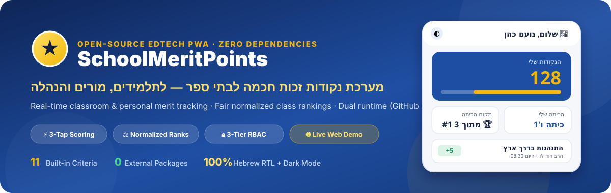
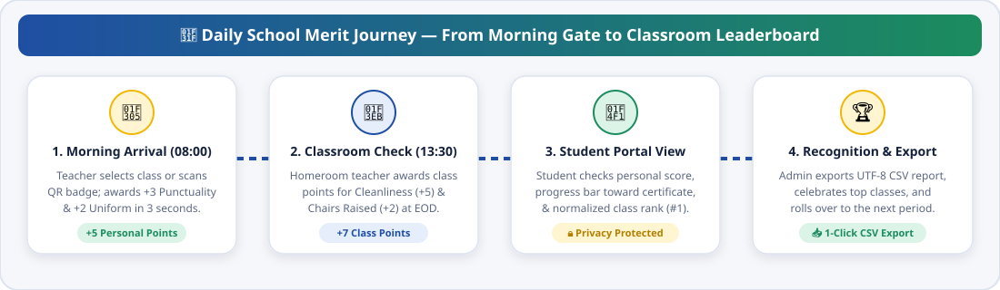
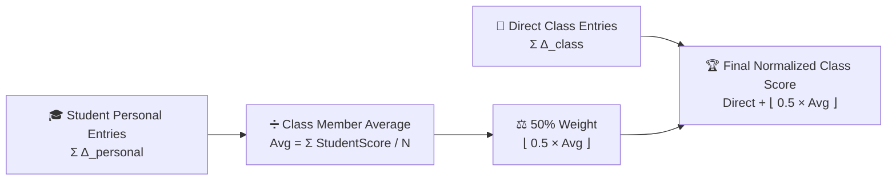
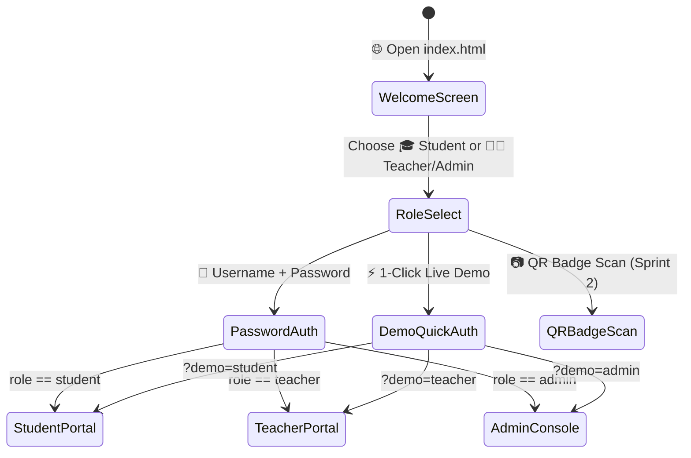
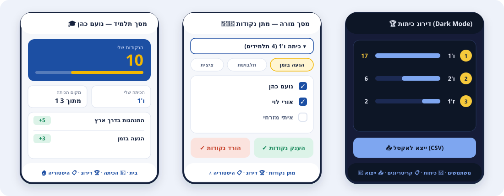
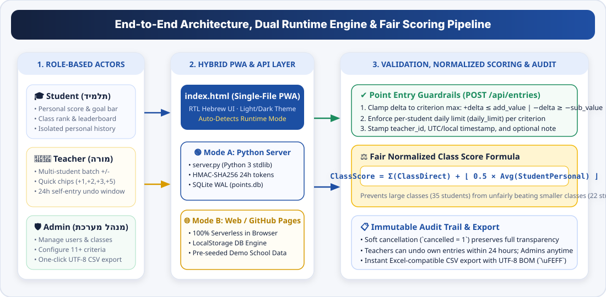
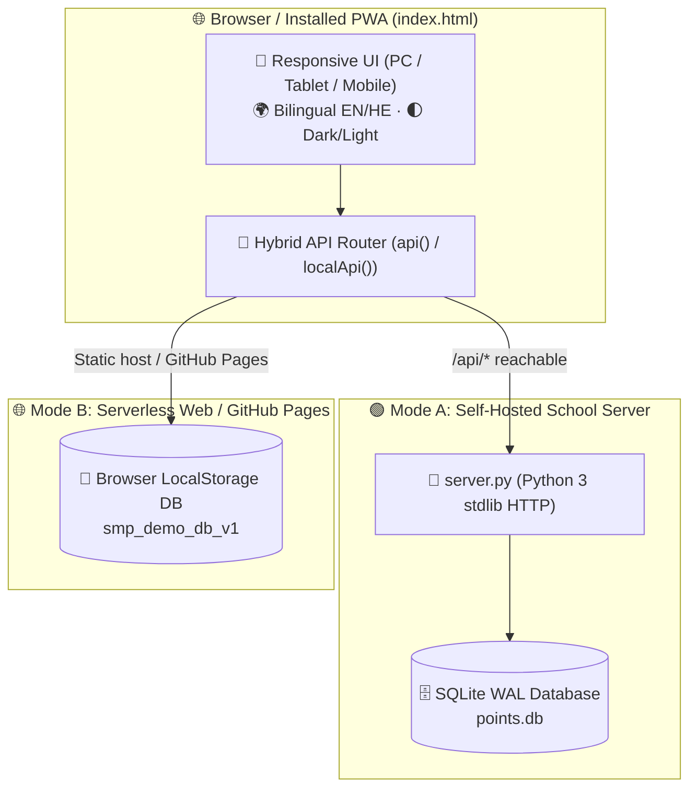
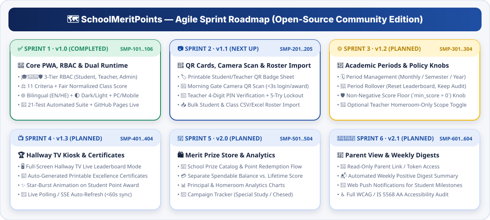

# ⭐ SchoolMeritPoints — Product & Architecture Specification

**Open-Source Release · MIT License · Bilingual (EN / HE) · PC, Tablet & Mobile PWA**

> 🌍 **Mission**: SchoolMeritPoints is a free, open-source Progressive Web App for schools. There are no subscriptions, per-user licenses, or external dependencies. Schools can run it from GitHub Pages or self-host on any Python 3 + SQLite machine.

[🚀 **Launch Live App (`index.html`)**](https://rajwanyair.github.io/SchoolMeritPoints/index.html) ·
[🎨 **Interactive Visual Spec (`spec.html`)**](https://rajwanyair.github.io/SchoolMeritPoints/spec.html) ·
[🗺️ **Agile Sprint Roadmap (`ROADMAP.md`)**](ROADMAP.md) ·
[📖 **Repository README (`README.md`)**](README.md)

---

## 📑 Table of Contents

1. [🎯 System Vision & Scope](#1--system-vision--scope)
2. [👥 User Roles & RBAC Permissions](#2--user-roles--rbac-permissions)
3. [⚖️ Merit Criteria & Normalized Scoring Math](#3-️-merit-criteria--normalized-scoring-math)
4. [🔐 Authentication & Access Flows](#4--authentication--access-flows)
5. [📱 Visual Screens & Multi-Device Layout](#5--visual-screens--multi-device-layout)
6. [🎨 Design System, Accessibility & Themes](#6--design-system-accessibility--themes)
7. [🗄️ Data Model & Event-Sourced Ledger](#7-️-data-model--event-sourced-ledger)
8. [🛡️ Student Privacy & Security Guardrails](#8-️-student-privacy--security-guardrails)
9. [🏗️ Open-Source Architecture & Runtime Modes](#9-️-open-source-architecture--runtime-modes)
10. [🗺️ Agile Development Sprints & Roadmap Summary](#10-️-agile-development-sprints--roadmap-summary)
11. [✅ Quality Gates & Automated Verification](#11--quality-gates--automated-verification)
12. [⚙️ Configurable School Policy Knobs](#12-️-configurable-school-policy-knobs)

---

## 1. 🎯 System Vision & Scope

**SchoolMeritPoints** reinforces positive student conduct and classroom teamwork with a transparent, fair, and fast merit tracking system. A teacher can award points to an entire class in under three seconds, and students immediately see why points were awarded and how their classroom ranks.

  

### ✅ Core Capabilities (v1.0 — Implemented)

- 🌟 **Personal Merit Tracking**: Award or deduct points per student with criterion and teacher attribution.
🏫 **Normalized Classroom Merit Tracking**: Direct classroom points combined with 50% of the class's average personal score.
🏆 **Live Leaderboards**: Real-time class rankings and teacher-visible student rankings with progress bars.
📋 **Immutable Audit Log & 24h Undo**: Every action is timestamped; teachers can undo their own entries within 24 hours.
🌍 **Bilingual & Multi-Device**: Hebrew (`RTL`) and English (`LTR`) switching, Light/Dark themes, and responsive layouts for PC (`≥1024px`), Tablet (`768px–1023px`), and Mobile (`<768px`).
📥 **One-Click CSV Export**: UTF-8 BOM CSV export compatible with Microsoft Excel and LibreOffice.

### 🔭 Out of Scope (Non-Goals)

- ❌ Academic exam grading or official government attendance reporting.
- ❌ Student-to-student chat or social messaging.

---

## 2. 👥 User Roles & RBAC Permissions

```mermaid
flowchart TB
    subgraph Actors["👥 School Community Roles"]
        S["🎓 Student (תלמיד)"]
        T["👨‍🏫 Teacher (מורה)"]
        A["🛡️ Admin (מנהל מערכת)"]
    end

    subgraph Capabilities["🔒 Role-Based Capabilities"]
        S1["📊 View Own Score & Goal Bar"]
        S2["🏆 View Class Rank & Class Leaderboard"]
        S3["📋 View Own & Classroom History"]

        T1["⚡ Batch Award / Deduct Points (+1..+10)"]
        T2["↩️ Undo Own Entries (< 24 Hours)"]
        T3["📈 View Student & Class Leaderboards"]
        T4["📥 Export Audit Log to UTF-8 CSV"]

        A1["👤 Manage Users (Admin / Teacher / Student)"]
        A2["🏫 Manage Classes & Student Enrollment"]
        A3["📋 Configure & Toggle Merit Criteria"]
        A4["🛡️ Undo Any Entry Anytime"]
    end

    S --> S1 & S2 & S3
    T --> T1 & T2 & T3 & T4
    A --> T1 & T3 & T4 & A1 & A2 & A3 & A4
```

| Role | Emoji | Key Responsibilities & Permissions |
| :--- | :---: | :--- |
| **Student (`student`)** | 🎓 | Views personal score, progress bar, class score, class rank, and personal/class history. Cannot view other students' personal scores or modify any data. |
| **Teacher (`teacher`)** | 👨‍🏫 | Awards or deducts points for single students, multi-selected student batches, or entire classes; views class & student leaderboards; undoes own entries within 24 hours; exports CSV. |
| **Admin (`admin`)** | 🛡️ | Full self-service control over users, classes, rosters, and merit criteria values/limits without code changes; can undo any entry at any time. |

---

## 3. ⚖️ Merit Criteria & Normalized Scoring Math

### 📋 Built-in Merit Categories (11 Default Rules)

Administrators can edit values, limits, and add new criteria directly from the Admin UI:

| # | Emoji | Criterion (EN) | Hebrew Name | Scope | Frequency / Limit | Award (`+`) | Deduct (`−`) |
| :-: | :-: | :--- | :--- | :---: | :---: | :---: | :---: |
| 1 | 👕 | **School Uniform** | תלבושת | `personal` | Daily (`1/day`) | `+2` | `−1` |
| 2 | 🧵 | **Tzitzit** | ציצית | `personal` | Daily (`1/day`) | `+2` | `−1` |
| 3 | ⏰ | **On-Time Arrival** | הגעה בזמן | `personal` | Daily (`1/day`) | `+3` | `−2` |
| 4 | 📚 | **Special Study Initiative** | מבצע חל"ל | `personal` | Per campaign (`∞`) | `+5` | — |
| 5 | 🤝 | **Exemplary Behavior** | התנהגות בדרך ארץ | `personal` | Unlimited (`∞`) | `+5` | `−3` |
| 6 | 🧹 | **Classroom Cleanliness** | סדר וניקיון הכיתה | `class` | Daily (`1/day`) | `+5` | `−3` |
| 7 | ✨ | **Clean Classroom Walls** | קירות נקיים | `class` | Weekly (`∞`) | `+3` | `−3` |
| 8 | 🎨 | **Decorated Classroom** | כיתה מקושטת | `class` | Monthly (`∞`) | `+10` | — |
| 9 | 🪑 | **Chairs Raised at EOD** | הרמת כיסאות בסוף היום | `class` | Daily (`1/day`) | `+2` | `−2` |
| 10 | 📋 | **Classroom Duty Monitors** | תורנים כיתתיים | `class` | Daily (`1/day`) | `+3` | `−2` |
| 11 | 🗄️ | **Organized Cubbies** | כוורות מסודרות | `class` | Weekly (`∞`) | `+3` | `−2` |

### 🧮 Mathematical Scoring Model

- **Personal Score**:
  $$\text{StudentScore}(s) = \sum_{e \in \text{Entries}(s),\, \neg e.\text{cancelled}} \Delta_e$$
- **Fair Normalized Class Score** (prevents large classes from outscoring smaller classes solely due to headcount):
  $$\text{ClassScore}(c) = \sum_{e \in \text{Direct}(c)} \Delta_e \;+\; \left\lfloor 0.5 \times \frac{1}{|S_c|} \sum_{s \in S_c} \text{StudentScore}(s) \right\rfloor$$

---

## 4. 🔐 Authentication & Access Flows

- 🔑 **Password Sign-In**: Salted `SHA-256` password verification issuing a signed 24-hour `HMAC-SHA256` session token.
⚡ **Instant Demo Sign-In**: Pre-seeded one-click role buttons (`noam`, `david`, `admin`) and URL deep links (`?demo=student|teacher|admin`).
📷 **QR Badge & PIN Sign-In (Sprint 2 — `SMP-201..203`)**: Printable random-UUID QR cards for students and teachers, with a 4-digit PIN gate for teachers and five-attempt lockout protection.

---

## 5. 📱 Visual Screens & Multi-Device Layout

  

| Screen / Portal | Mobile (`< 768px`) | Tablet (`768px–1023px`) | PC / Desktop (`≥ 1024px`) |
| :--- | :--- | :--- | :--- |
| 🔐 **Welcome & Sign-In** | Full-height vertical stack with one-click demo bar | Elevated `480px` card with shadow | Centered card + top language/theme bar |
| 🎓 **Student Portal** | Hero score card + mini cards + recent feed + bottom tabs | Centered `820px` view | 2-column grid + side rail |
| 👨‍🏫 **Teacher Portal** | Class selector + criteria chips + quick +/- bar + student checklist | Centered modal class picker | Left/Right navigation sidebar + wide workspace |
| 🛡️ **Admin Console** | Scrollable user/class/criteria cards + modal forms + CSV export | Wide tables + centered modals | Full sidebar console + CSV download |

---

## 6. 🎨 Design System, Accessibility & Themes

- 🌍 **Bilingual Directionality**: `dir="rtl"` for Hebrew (`עב`) and `dir="ltr"` for English (`EN`) using CSS logical properties.
- 🌓 **Light & Dark Themes**: Semantic tokens with OS `prefers-color-scheme` detection and a manual theme toggle.
- 🔤 **Typography**: **Secular One** for display headings and **Assistant** for body text with `font-variant-numeric: tabular-nums`.
- ♿ **Accessibility**: Large touch targets (≥44 px), semantic color + sign pairing (`+` green, `−` red), and keyboard-navigable controls.

---

## 7. 🗄️ Data Model & Event-Sourced Ledger

  

| Table | Primary Key | Key Columns | Purpose |
| :--- | :---: | :--- | :--- |
| 👤 **`users`** | `id` | `name`, `role`, `username`, `password`, `barcode`, `active`, `pin` | Stores students, teachers, and admins (no national ID numbers stored). |
| 🏫 **`classes`** | `id` | `name`, `grade`, `teacher_id` | Classroom definitions and homeroom teacher assignment. |
| 👥 **`class_members`** | `(student_id, class_id, year)` | `student_id`, `class_id`, `year` | Maps students to classes per school year without losing history. |
| 📋 **`criteria`** | `id` | `name`, `kind`, `add_value`, `sub_value`, `daily_limit`, `active` | Admin-configurable personal and classroom merit categories. |
| ⭐ **`entries`** | `id` | `target_type`, `target_id`, `criterion_id`, `delta`, `teacher_id`, `note`, `ts`, `cancelled` | Append-only event ledger; undone entries set `cancelled = 1`. |
| 📅 **`periods`** | `id` | `name`, `start_date`, `end_date` | Academic scoring periods (monthly, semester, yearly). |

---

## 8. 🛡️ Student Privacy & Security Guardrails

- 🔒 **Zero Sensitive PII**: Stores only display name, classroom, and merit events—never national ID numbers, home addresses, phone numbers, or photos.
- 🙈 **Student Score Isolation**: Students can only query their own personal score (`/api/student-score` enforces `403 Forbidden` if a student requests another student's ID) and the school-wide class leaderboard.
- 🔑 **Cryptographic Session Tokens**: Passwords are salted and hashed with `SHA-256`; sessions use `HMAC-SHA256` signatures with a strict 24-hour expiration window.
- 🧾 **Complete Auditability**: Every point addition, deduction, and cancellation records the acting teacher and timestamp and can be exported to CSV at any time.

---

## 9. 🏗️ Open-Source Architecture & Runtime Modes

| Runtime Mode | How It Works | Best For |
| :--- | :--- | :--- |
| 🟢 **Mode A: Local / School Python Server** | `python3 server.py --port 8080` serves `index.html` and persists all multi-user data in SQLite WAL (`points.db`). | Production school deployment on any Linux, Windows, macOS, or Raspberry Pi machine. |
| 🌐 **Mode B: Serverless Web (GitHub Pages)** | `index.html` automatically activates `localApi` backed by `localStorage` with pre-seeded demo classes, teachers, and students. | Instant online demos, testing from any device anywhere on the web, and zero-install evaluation. |

---

## 10. 🗺️ Agile Development Sprints & Roadmap Summary

All sprint deliverables (`SMP-101` through `SMP-605`), release gates, and tracked engineering issues (`ISS-001` through `ISS-012`) are maintained in **[`ROADMAP.md`](ROADMAP.md)**:

  

👉 **See [`ROADMAP.md`](ROADMAP.md) for the authoritative sprint schedule, task status matrix, and issue backlog.**

---

## 11. ✅ Quality Gates & Automated Verification

1. ⚡ **3-Second Classroom Scoring**: A teacher can select a class, choose a criterion, select all students, and award points in under 3 seconds.
2. 💻 **Cross-Platform & Multi-Device**: Verified on Mobile (`<768px`), Tablet (`768px–1023px`), and PC (`≥1024px`) across modern browsers.
3. 🌍 **Bilingual & Bidirectional**: Complete parity between Hebrew (`RTL`) and English (`LTR`) across all UI strings and seeded records.
4. 🔒 **RBAC & Privacy Enforcement**: Students are strictly blocked (`403 Forbidden`) from viewing other students' personal scores or mutating state.
5. 🧪 **Mandatory Automated Test Suite**: Every method, API endpoint, frontend function, i18n key, SVG diagram, and documentation link is checked by `python3 -m unittest discover -s tests -v` through `.githooks/pre-commit` and GitHub Actions CI.

---

## 12. ⚙️ Configurable School Policy Knobs

Schools deploying **SchoolMeritPoints** can tailor the following educational policy settings (implemented in Admin Console & Sprint 3):

- 🏆 **In-Class Student Leaderboard Visibility**: Disabled for students by default to protect lower-scoring students; visible to teachers and admins.
- 📉 **Deduction Policy per Criterion**: Any criterion can be configured as award-only (`sub_value = 0`, e.g., *Decorated Classroom*) or bidirectional (`+add` / `−sub`).
- 🗓️ **Scoring Period Cadence**: Monthly, semester, or annual leaderboard cycles with full historical archive preservation.
- 🏫 **Teacher Scoring Scope**: Open school-wide scoring (any teacher can award points to any class/student) versus homeroom-restricted scoring.
